# KYRA ZAM 2.0 — Production Hardening & Controlled Deployment Implementation Plan

**Document Reference**: `docs/audit/IMPLEMENTATION_PLAN.md`  
**Execution Phase**: Phase 5 — Implementation Planning  
**Author**: Principal Software Architect & Application Security Lead  
**Repository**: `https://github.com/growphil/kyra-zam.git`  
**Audited Commit**: `5d8f64322191cd9cc4207e077a12463082f04548` (branch: `main`)  
**Status**: Approved Architecture & Implementation Blueprint (Planning Only — No Source Code Changes)  

---

## 1. Executive Summary

This implementation plan provides the definitive, dependency-aware blueprint to remediate confirmed vulnerabilities, eliminate build and runtime blockers, establish automated regression suites, and prepare **KYRA ZAM 2.0** for production release.

All tasks are derived directly from the verified findings in:
- `docs/audit/REPOSITORY_AUDIT.md` (Deliverable 1)
- `docs/audit/REQUIREMENTS_TRACEABILITY.md` (Deliverable 2)
- `docs/audit/PRODUCTION_RISK_REGISTER.md` (Deliverable 3)
- `docs/audit/PHASE3_VALIDATION.md` (Phase 3 Technical Validation)
- `docs/audit/BASELINE_TEST_RESULTS.md` (Phase 4 Command Outputs)
- `docs/audit/PHASE4_BLOCKERS.md` (Phase 4 Blockers Analysis)

### Operating Constraints & Non-Negotiables
1. **Zero Source Code Alterations in Phase 5**: This phase produces the actionable implementation plan. Code changes commence exclusively in Phase 6 following formal approval.
2. **Database Protection**: Zero drops, resets, truncations, or manual edits to `_prisma_migrations` on production AWS RDS (`kyra-zam-db`).
3. **Additive, Backward-Compatible Changes**: Preserves existing business logic, database relationships, and user sessions wherever safe.
4. **Test-Driven Verification**: Every batch includes automated regression tests reproducing the defect prior to fix validation.

---

## 2. Master Implementation Sequencing & Dependency Graph

```mermaid
flowchart TD
    subgraph Batch E1: Test Infrastructure Bootstrap
        T0[TASK-TEST-01: Bootstrap Vitest & Supertest Harness]
    end

    subgraph Batch A: Critical Security Hardening
        A1[TASK-SEC-01: Eliminate User Identity Role Fallback<br/>RISK-CRIT-01 / BLK-04]
        A2[TASK-SEC-02: Require Auth on WebSockets & Revoke Guest Roles<br/>RISK-CRIT-02 / BLK-05]
        A3[TASK-TEST-02: Auth & WS Authorization Regression Tests]
    end

    subgraph Batch B: Authentication Hardening
        B1[TASK-SEC-03: Restrict CORS to Configured Whitelist<br/>RISK-HIGH-01]
        B2[TASK-SEC-04: Remove JWT Query Parameter Acceptance<br/>RISK-HIGH-02]
        B3[TASK-SEC-05: Enforce Configured JWT Expiry<br/>RISK-HIGH-03]
        B4[TASK-SEC-06: Implement Refresh Token Rotation & Invalidation<br/>RISK-MED-01]
        B5[TASK-TEST-03: CORS, Token Expiry & Rotation Tests]
    end

    subgraph Batch C: Build & Runtime Reliability
        C1[TASK-BLD-01: Delete Incompatible prisma.config.ts<br/>RISK-HIGH-07 / BLK-02]
        C2[TASK-BLD-02: Remove Defunct Worker Script from package.json<br/>RISK-MED-02 / BLK-01]
        C3[TASK-BLD-03: Fix Frontend ESLint Flat Config<br/>BLK-03]
        C4[TASK-BLD-04: Remove Next.js Error Suppression Flags<br/>RISK-HIGH-06]
    end

    subgraph Batch D: Database & Business Integrity
        D1[TASK-INT-01: Atomic Stock Increment in CellService<br/>RISK-HIGH-04]
        D2[TASK-INT-02: Collision-Safe Sequential Number Generation<br/>RISK-HIGH-05]
        D3[TASK-INT-03: Row-Level Locking on QC Decision Updates<br/>RISK-MED-04]
        D4[TASK-TEST-04: Inventory, Finance & Warranty Concurrency Tests]
    end

    subgraph Batch F: Production Deployment Preparation
        F1[TASK-DEP-01: Verified RDS Migration Recovery Procedure<br/>RISK-CRIT-03 / BLK-06]
        F2[TASK-DEP-02: Container Build & Health Check Readiness]
    end

    T0 --> A1
    A1 --> A2 --> A3
    A3 --> B1
    B1 --> B2 --> B3 --> B4 --> B5
    B5 --> C1
    C1 --> C2 --> C3 --> C4
    C4 --> D1
    D1 --> D2 --> D3 --> D4
    D4 --> F1 --> F2
```



---

## 3. Detailed Task Specifications by Batch

### BATCH A — Critical Security

---

#### TASK-SEC-01: Eliminate User Identity Role Fallback
- **Task ID**: `TASK-SEC-01`
- **Linked Items**: `RISK-CRIT-01`, `REQ-SEC-02`, `BLK-04`
- **Severity**: **CRITICAL**
- **Root Cause & Evidence**:
  In `backend/src/plugins/auth.ts:L47-55` and `backend/src/middleware/rbac.ts:L32-40`, when a token's `payload.id` is not found, the backend queries `prisma.user.findFirst({ where: { roles: { hasSome: payload.roles }, isActive: true } })`. An attacker who crafts a JWT with a non-existent ID and role `SUPERADMIN` automatically assumes the identity of whichever active Superadmin is returned first by PostgreSQL.
- **Files Likely to Change**:
  - `backend/src/plugins/auth.ts`
  - `backend/src/middleware/rbac.ts`
- **Proposed Change**:
  1. Remove the entire `if (!user && payload.roles && payload.roles.length > 0)` block in `auth.ts`.
  2. Remove the entire `if (!dbUser && userPayload.roles && userPayload.roles.length > 0)` block in `rbac.ts`.
  3. If `payload.id` or `payload.email` does not resolve to an active user record, immediately respond with HTTP `401 Unauthorized` (`{ error: "Unauthorized", message: "User session invalid or account inactive. Please log in again." }`).
- **Dependencies**: `TASK-TEST-01` (Test Harness).
- **Regression Risks**: Existing browser clients with stale IDs from old development reseeds will be logged out and must sign in once.
- **Automated Verification Method**: Send request with valid JWT signature but invalid `id: "00000000-0000-0000-0000-000000000000"` and `roles: ["SUPERADMIN"]`.
- **Expected Result**: HTTP `401 Unauthorized`. Zero database queries matching other users.
- **Rollback Approach**: Revert git commit in `backend/src/plugins/auth.ts` and `backend/src/middleware/rbac.ts`.
- **Acceptance Criteria**: Pass automated test; no request with an invalid user ID succeeds, regardless of roles in payload.

---

#### TASK-SEC-02: Require Authentication on WebSockets & Revoke Guest Wildcard Roles
- **Task ID**: `TASK-SEC-02`
- **Linked Items**: `RISK-CRIT-02`, `REQ-SEC-04`, `BLK-05`
- **Severity**: **CRITICAL**
- **Root Cause & Evidence**:
  In `backend/src/server.ts:L126-138`, unauthenticated WebSocket handshakes fail `request.jwtVerify()`, catch the error silently, and assign `userId = "guest_user"` with **all 10 system roles** (`SUPERADMIN`, `ADMIN`, `INVENTORY_MANAGER`, etc.). Unauthenticated clients receive real-time push events containing sensitive financial, customer, and manufacturing data.
- **Files Likely to Change**:
  - `backend/src/server.ts`
  - `backend/src/websocket/manager.ts`
- **Proposed Change**:
  1. In `server.ts` `/ws` handler, require valid authentication.
  2. If `request.jwtVerify()` fails or token is missing, close the WebSocket connection with code `1008` (Policy Violation) and message `"Authentication required for WebSocket connection"`.
  3. If connecting anonymously for public health checks or telemetry, assign `userRoles = []` (zero subscriptions). Under no circumstances assign management roles to guest connections.
- **Dependencies**: `TASK-SEC-01`.
- **Regression Risks**: Frontend components attempting WebSocket connections before authentication tokens are initialized will be cleanly disconnected.
- **Automated Verification Method**: Connect to `/ws` without token -> Assert connection closed with code `1008`. Connect with valid technician token -> Assert only technician channels are accessible.
- **Expected Result**: Zero broadcast events sent to unauthenticated clients.
- **Rollback Approach**: Revert `server.ts` changes.
- **Acceptance Criteria**: Unauthenticated connection cannot receive any messages from `wsManager.broadcastToRoles(...)` or `wsManager.broadcastSales(...)`.

---

#### TASK-TEST-02: Auth & WS Authorization Regression Tests
- **Task ID**: `TASK-TEST-02`
- **Linked Items**: `RISK-CRIT-01`, `RISK-CRIT-02`, `MIS-01`
- **Severity**: **CRITICAL**
- **Proposed Change**: Write automated integration tests validating rejection of invalid user IDs, inactive accounts, and unauthenticated WebSockets.
- **Files Likely to Change**:
  - `backend/src/__tests__/auth-security.test.ts`
- **Dependencies**: `TASK-SEC-01`, `TASK-SEC-02`.
- **Acceptance Criteria**: 100% pass on security regression test suite.

---

### BATCH B — Authentication Hardening

---

#### TASK-SEC-03: Restrict CORS to Configured Whitelist
- **Task ID**: `TASK-SEC-03`
- **Linked Items**: `RISK-HIGH-01`, `REQ-SEC-06`
- **Severity**: **HIGH**
- **Root Cause & Evidence**:
  In `backend/src/plugins/cors.ts:L6-9`, `fastifyCors` is configured with `origin: true` and `credentials: true`, allowing any external website to make credentialed cross-origin requests.
- **Files Likely to Change**:
  - `backend/src/plugins/cors.ts`
  - `backend/.env`
- **Proposed Change**:
  Parse `process.env.CORS_ORIGIN` as a comma-separated list of allowed domains (e.g. `http://localhost:3000,https://kyrazam.vercel.app`).
  ```ts
  const allowedOrigins = (process.env.CORS_ORIGIN || "http://localhost:3000")
    .split(",")
    .map(o => o.trim());

  fastify.register(fastifyCors, {
    origin: (origin, cb) => {
      if (!origin || allowedOrigins.includes(origin) || allowedOrigins.includes("*")) {
        cb(null, true);
      } else {
        cb(new Error("CORS origin not allowed"), false);
      }
    },
    credentials: true,
  });
  ```
- **Dependencies**: None.
- **Regression Risks**: Developers running frontend on unlisted ports or preview URLs must add them to `CORS_ORIGIN`.
- **Automated Verification Method**: Send HTTP OPTIONS preflight request with `Origin: https://malicious-site.com`.
- **Expected Result**: Response does not return `Access-Control-Allow-Origin: https://malicious-site.com`.
- **Acceptance Criteria**: Only explicitly whitelisted origins receive allow-origin response headers.

---

#### TASK-SEC-04: Remove JWT Query Parameter Acceptance
- **Task ID**: `TASK-SEC-04`
- **Linked Items**: `RISK-HIGH-02`, `REQ-SEC-05`
- **Severity**: **HIGH**
- **Root Cause & Evidence**:
  `backend/src/plugins/auth.ts:L29-32`, `backend/src/middleware/rbac.ts:L13-16`, and `backend/src/server.ts:L121-124` inspect `(request.query as any)?.token` and copy it to `request.headers.authorization`. This causes tokens to leak into server access logs, reverse proxies, and browser referer headers.
- **Files Likely to Change**:
  - `backend/src/plugins/auth.ts`
  - `backend/src/middleware/rbac.ts`
  - `backend/src/server.ts`
- **Proposed Change**:
  Remove query string token extraction from `auth.ts` and `rbac.ts`. Require tokens in the HTTP `Authorization: Bearer <token>` header. For WebSocket connection initialization, pass token via the standard `Sec-WebSocket-Protocol` header or Authorization header during HTTP upgrade.
- **Dependencies**: None.
- **Regression Risks**: Any existing client code appending `?token=` must supply the standard `Authorization` header.
- **Automated Verification Method**: Send GET request with `?token=<JWT>` without Authorization header.
- **Expected Result**: HTTP `401 Unauthorized`.
- **Acceptance Criteria**: Zero routes accept JWTs via URL query string.

---

#### TASK-SEC-05: Enforce Configured JWT Expiry
- **Task ID**: `TASK-SEC-05`
- **Linked Items**: `RISK-HIGH-03`, `REQ-SEC-07`
- **Severity**: **HIGH**
- **Root Cause & Evidence**:
  `backend/src/routes/auth.ts:L24` hardcodes `expiresIn: "365d"`, and line 89 hardcodes `expiresIn: "30d"`, ignoring `.env` (`JWT_EXPIRY="60m"`).
- **Files Likely to Change**:
  - `backend/src/routes/auth.ts`
- **Proposed Change**:
  Use `process.env.JWT_EXPIRY || "60m"` in both login and refresh routes. Ensure access tokens expire in 60 minutes as documented in infrastructure templates.
- **Dependencies**: None.
- **Regression Risks**: Client applications must call `/auth/refresh` upon token expiry.
- **Automated Verification Method**: Issue token via `/auth/login`; decode payload and inspect `exp - iat`.
- **Expected Result**: `exp - iat` equals 3600 seconds (60 minutes).
- **Acceptance Criteria**: No access tokens are issued with multi-month lifetimes.

---

#### TASK-SEC-06: Implement Refresh Token Rotation & Invalidation
- **Task ID**: `TASK-SEC-06`
- **Linked Items**: `RISK-MED-01`, `REQ-SEC-07`
- **Severity**: **MEDIUM**
- **Root Cause & Evidence**:
  In `backend/src/routes/auth.ts:L55-91`, refreshing an access token does not rotate the refresh token or update `revokedAt`. A compromised refresh token remains valid for 90 days.
- **Files Likely to Change**:
  - `backend/src/routes/auth.ts`
- **Proposed Change**:
  When `/auth/refresh` receives a valid refresh token:
  1. Revoke the used refresh token (`update({ where: { id: validTokenRow.id }, data: { revokedAt: new Date() } })`).
  2. Generate a fresh cryptographically random refresh token, hash it with bcrypt, and persist in `RefreshToken`.
  3. Return both new `accessToken` and new `refreshToken: ${userId}:${newRawToken}`.
  4. If a revoked refresh token is presented, invalidate all active tokens for that user (replay attack detection).
- **Dependencies**: `TASK-SEC-05`.
- **Regression Risks**: Client must store and use the replacement refresh token returned by the endpoint.
- **Automated Verification Method**: Call `/auth/refresh` twice with the same refresh token.
- **Expected Result**: First call succeeds with new token pair; second call fails with HTTP `401 Unauthorized`.
- **Acceptance Criteria**: Refresh tokens are strictly single-use.

---

### BATCH C — Build & Runtime Reliability

---

#### TASK-BLD-01: Delete Incompatible `prisma.config.ts`
- **Task ID**: `TASK-BLD-01`
- **Linked Items**: `RISK-HIGH-07`, `REQ-DB-03`, `BLK-02`
- **Severity**: **HIGH**
- **Root Cause & Evidence**:
  `backend/prisma.config.ts` imports `{ defineConfig } from "prisma/config"`. In Prisma 5.22.0, this module does not exist, causing TypeScript and ts-node to throw `TS2307: Cannot find module 'prisma/config'`.
- **Files Likely to Change**:
  - `backend/prisma.config.ts` (Delete file)
  - `backend/Dockerfile:L21` (Remove `COPY prisma.config.ts ./`)
- **Proposed Change**:
  Delete `backend/prisma.config.ts`. Remove line 21 in `backend/Dockerfile`. Prisma 5.22 natively reads database connection parameters from `prisma/schema.prisma` and `.env`.
- **Dependencies**: None.
- **Regression Risks**: None. Prisma 5 CLI never consumed `prisma.config.ts`.
- **Automated Verification Method**: Run `npx prisma generate` and `npm run build` in `backend/`.
- **Expected Result**: Clean execution with 0 errors.
- **Acceptance Criteria**: No references to `prisma/config` remain in the repository.

---

#### TASK-BLD-02: Clean Defunct Worker Script from `package.json`
- **Task ID**: `TASK-BLD-02`
- **Linked Items**: `RISK-MED-02`, `REQ-OPS-01`, `BLK-01`
- **Severity**: **MEDIUM**
- **Root Cause & Evidence**:
  `backend/package.json:L14` defines `"worker": "ts-node src/queues/worker.ts"`, but directory `src/queues` does not exist on disk.
- **Files Likely to Change**:
  - `backend/package.json`
- **Proposed Change**:
  Remove `"worker": "ts-node src/queues/worker.ts"` from `backend/package.json`.
- **Dependencies**: None.
- **Regression Risks**: None; worker script was non-functional.
- **Automated Verification Method**: Inspect `backend/package.json` scripts.
- **Expected Result**: All defined npm scripts map to existing executable files.
- **Acceptance Criteria**: No defunct or crashing commands in package manifests.

---

#### TASK-BLD-03: Fix Frontend ESLint Flat Configuration
- **Task ID**: `TASK-BLD-03`
- **Linked Items**: `BLK-03`, `REQ-UI-01`
- **Severity**: **HIGH**
- **Root Cause & Evidence**:
  `frontend/eslint.config.mjs` throws `Cannot find module '.../eslint-config-next/core-web-vitals'` because ESM path resolution expects `.js` extension.
- **Files Likely to Change**:
  - `frontend/eslint.config.mjs`
- **Proposed Change**:
  Correct the import path or use standard Next.js 15 flat config export:
  ```js
  import { dirname } from "path";
  import { fileURLToPath } from "url";
  import { FlatCompat } from "@eslint/eslintrc";

  const __filename = fileURLToPath(import.meta.url);
  const __dirname = dirname(__filename);

  const compat = new FlatCompat({
    baseDirectory: __dirname,
  });

  const eslintConfig = [
    ...compat.extends("next/core-web-vitals", "next/typescript"),
  ];

  export default eslintConfig;
  ```
- **Dependencies**: None.
- **Regression Risks**: None.
- **Automated Verification Method**: Run `npm run lint` in `frontend/`.
- **Expected Result**: Clean execution with exit code 0.
- **Acceptance Criteria**: `npm run lint` executes without module resolution crashes.

---

#### TASK-BLD-04: Remove Next.js Error Suppression Flags
- **Task ID**: `TASK-BLD-04`
- **Linked Items**: `RISK-HIGH-06`, `REQ-UI-01`
- **Severity**: **HIGH**
- **Root Cause & Evidence**:
  `frontend/next.config.ts:L5-10` enables `ignoreDuringBuilds: true` and `ignoreBuildErrors: true`, masking lint and type errors during Vercel builds.
- **Files Likely to Change**:
  - `frontend/next.config.ts`
- **Proposed Change**:
  Remove `eslint` and `typescript` ignore blocks from `frontend/next.config.ts`.
  ```ts
  import type { NextConfig } from "next";

  const nextConfig: NextConfig = {
    // Strict production settings
  };

  export default nextConfig;
  ```
- **Dependencies**: `TASK-BLD-03`.
- **Regression Risks**: Exposes any real TypeScript or lint errors during build. (Phase 4 proved `tsc --noEmit` is clean; only ESLint path needed fixing).
- **Automated Verification Method**: Run `npm run build` in `frontend/`.
- **Expected Result**: Build passes with strict verification enabled.
- **Acceptance Criteria**: No build suppression flags remain in `next.config.ts`.

---

### BATCH D — Database & Business Integrity

---

#### TASK-INT-01: Atomic Stock Increment in Cell Service
- **Task ID**: `TASK-INT-01`
- **Linked Items**: `RISK-HIGH-04`, `REQ-INV-01`
- **Severity**: **HIGH**
- **Root Cause & Evidence**:
  In `backend/src/services/cell.service.ts:L61`, `quantity: material.quantity + validated.quantity` performs an in-memory addition rather than an atomic database increment. Under concurrent inward transactions for the same SKU, one transaction's increment overwrites the other, permanently losing stock.
- **Files Likely to Change**:
  - `backend/src/services/cell.service.ts`
- **Proposed Change**:
  Replace with Prisma's atomic increment operator:
  ```ts
  material = await tx.material.update({
    where: { id: material.id },
    data: {
      quantity: { increment: validated.quantity },
      lastRestock: new Date()
    }
  });
  ```
- **Dependencies**: None.
- **Regression Risks**: None.
- **Automated Verification Method**: Execute concurrent inward batch creation simulation.
- **Expected Result**: Final stock equals baseline stock + sum of all concurrent batch quantities.
- **Acceptance Criteria**: Zero lost stock updates during concurrent inward batches.

---

#### TASK-INT-02: Collision-Safe Sequential Number Generation
- **Task ID**: `TASK-INT-02`
- **Linked Items**: `RISK-HIGH-05`, `REQ-PROD-01`
- **Severity**: **HIGH**
- **Root Cause & Evidence**:
  In `backend/src/routes/sales.ts:L18-22` and `dispatch.ts:L7-15`, sequential number generation relies on an unlocked `findFirst` loop. Concurrent requests receive the same candidate number and crash with `P2002: Unique constraint failed`.
- **Files Likely to Change**:
  - `backend/src/routes/sales.ts`
  - `backend/src/routes/dispatch.ts`
  - `backend/src/routes/salesOrders.ts`
- **Proposed Change**:
  Implement transaction-safe retry handling or sequence generation: If a unique constraint violation (`P2002`) occurs on order number insertion, automatically retry the transaction with the next incremented sequence number (up to 3 retries).
- **Dependencies**: None.
- **Regression Risks**: None.
- **Automated Verification Method**: Concurrently invoke order creation 5 times.
- **Expected Result**: All 5 orders succeed with distinct sequential numbers.
- **Acceptance Criteria**: Zero `P2002` crashes under concurrent order creation.

---

#### TASK-INT-03: Row-Level Locking on QC Decision Updates
- **Task ID**: `TASK-INT-03`
- **Linked Items**: `RISK-MED-04`, `REQ-QC-01`
- **Severity**: **MEDIUM**
- **Root Cause & Evidence**:
  In `backend/src/routes/quality.ts:L383-410`, the cell lookup occurs outside the transaction, and the subsequent update inside `$transaction` does not acquire a row-level lock. Concurrent decisions from multiple inspectors can cause lost updates or contradictory audit trails.
- **Files Likely to Change**:
  - `backend/src/routes/quality.ts`
- **Proposed Change**:
  Acquire an exclusive row lock within the transaction before inspecting status:
  ```ts
  await tx.$executeRawUnsafe(
    `SELECT * FROM "Cell" WHERE "serialNumber" = $1 FOR UPDATE`,
    serial
  );
  const cell = await tx.cell.findUnique({ where: { serialNumber: serial } });
  ```
- **Dependencies**: None.
- **Regression Risks**: None.
- **Automated Verification Method**: Submit concurrent conflicting QC decisions for the same cell serial.
- **Expected Result**: One decision commits; the subsequent decision detects the updated status and returns HTTP 400.
- **Acceptance Criteria**: State machine transitions are serialized and deterministic.

---

### BATCH E — Automated Regression Testing

---

#### TASK-TEST-01: Bootstrap Vitest & Supertest Harness
- **Task ID**: `TASK-TEST-01`
- **Linked Items**: `RISK-MED-03`, `MIS-01`, `BLK-07`
- **Severity**: **HIGH**
- **Proposed Change**:
  1. Install `vitest` and `supertest` in `backend/devDependencies`.
  2. Create `backend/vitest.config.ts`.
  3. Add `"test": "vitest run"` and `"test:watch": "vitest"` to `backend/package.json`.
  4. Create test helper `backend/src/__tests__/helpers/app.ts` providing an ephemeral Fastify test instance with database mock or disposable connection.
- **Files Likely to Change**:
  - `backend/package.json`
  - `backend/vitest.config.ts`
  - `backend/src/__tests__/helpers/app.ts`
- **Dependencies**: None.
- **Acceptance Criteria**: `npm test` executes cleanly and outputs structured test results.

---

#### TASK-TEST-04: Domain Regression Test Suite
- **Task ID**: `TASK-TEST-04`
- **Linked Items**: `REQ-INV-01`, `REQ-FIN-01`, `REQ-WAR-01`
- **Severity**: **HIGH**
- **Proposed Change**:
  Author integration tests verifying:
  1. `inventory-integrity.test.ts`: Insufficient stock rejection, atomic increments.
  2. `financial-clearance.test.ts`: Dispatch blocked when `isFinancialCleared === false`.
  3. `warranty-validation.test.ts`: Rejection of warranty activation when pack is not `SOLD_TO_CUSTOMER` or dispatch is not `DELIVERED`.
- **Files Likely to Change**:
  - `backend/src/__tests__/inventory-integrity.test.ts`
  - `backend/src/__tests__/financial-clearance.test.ts`
  - `backend/src/__tests__/warranty-validation.test.ts`
- **Dependencies**: `TASK-TEST-01`, `TASK-INT-01`, `TASK-INT-03`.
- **Acceptance Criteria**: All business invariants verified through automated assertions.

---

### BATCH F — Production Deployment Preparation & RDS Recovery

---

#### TASK-DEP-01: Documented Production RDS Migration Resolution Procedure
- **Task ID**: `TASK-DEP-01`
- **Linked Items**: `RISK-CRIT-03`, `REQ-DB-02`, `BLK-06`
- **Severity**: **CRITICAL**
- **Context**: AWS RDS `kyra-zam-db` is inside a private VPC (`172.31.0.62`) accessible only from the production EC2 instance. The database previously failed migration `20260825165600`.
- **Step-by-Step Execution Plan on Production EC2**:
  1. **Pre-flight Backup**: Create an immediate manual AWS RDS snapshot:
     ```bash
     aws rds create-db-snapshot --db-instance-identifier kyra-zam-db --db-snapshot-identifier pre-migration-recovery-$(date +%s) --region ap-south-1
     ```
  2. **Verify Migration Status on EC2**:
     ```bash
     cd /home/ubuntu/kyra-zam/backend
     npx prisma migrate status
     ```
  3. **Resolve Failed Migration Entry**:
     ```bash
     npx prisma migrate resolve --rolled-back "20260825165600_add_hardening_indexes"
     ```
  4. **Deploy Missing Migrations**:
     ```bash
     npx prisma migrate deploy
     ```
     This deploys `20260825160000_add_enterprise_schema`, then `20260825165600_add_hardening_indexes`, `20260825174700`, and `20260825181400` in their exact timestamp order.
  5. **Post-Migration Verification**:
     ```bash
     npx prisma migrate status
     ```
     Must report: `Database schema is up to date!`
- **Dependencies**: Verified code pushed to GitHub; access to production EC2.
- **Acceptance Criteria**: Production RDS has all 6 migrations applied with zero data loss and 0% drift.

---

#### TASK-DEP-02: Container Build & Health Check Readiness
- **Task ID**: `TASK-DEP-02`
- **Linked Items**: `REQ-OPS-02`
- **Severity**: **HIGH**
- **Proposed Change**:
  1. Verify backend `Dockerfile` multi-stage build cleanly packages `dist/` and Prisma client.
  2. Verify `docker-compose.prod.yml` configuration (backend port 8000, sidecar port 8001, Redis port 6379).
  3. Verify health checks (`/health`) return HTTP 200 on all containers.
- **Files Likely to Change**:
  - `docker-compose.prod.yml`
  - `backend/Dockerfile`
- **Dependencies**: Batches A–D.
- **Acceptance Criteria**: `docker-compose -f docker-compose.prod.yml config` passes validation; containers build and start cleanly.

---

## 4. Production Release Gates

Before approving production release (Phase 7 / Phase 8), the following gates must be satisfied:

```
[ GATE 1: Dependency & Build Integrity ]
  ├── Backend build (`npm run build`) exits 0 with strict TypeScript checks
  ├── Frontend build (`next build`) exits 0 with zero lint or type suppression
  └── Sidecar syntax compilation and FastAPI app imports succeed

[ GATE 2: Security Validation ]
  ├── Automated tests prove rejection of invalid user IDs (no Superadmin fallback)
  ├── WebSocket rejects unauthenticated handshakes; guest role array deleted
  ├── CORS restricts origins to explicit whitelist
  └── Access tokens expire in 60m; refresh tokens rotate on use

[ GATE 3: Database & Invariant Integrity ]
  ├── Disposable database migration reproduces 0.00% schema drift
  ├── Concurrent stock increments verified atomic
  ├── Financial clearance strictly gating dispatch orders
  └── Warranty activation gating on SOLD_TO_CUSTOMER and DELIVERED status

[ GATE 4: Deployment Safety ]
  ├── Manual RDS snapshot created before migration resolution
  ├── Zero database resets or drops on production
  └── All container health checks report {"status": "ok"}
```

---

## 5. Unresolved Architecture Decisions Requiring Clarification

1. **Active AWS Deployment Target (EC2 vs ECS Fargate)**:
   - The repository contains both `docker-compose.prod.yml` (EC2) and `aws/ecs-task-definition.json` (ECS Fargate). The implementation plan accommodates EC2 Docker Compose by default as requested. If ECS Fargate is desired, GitHub Actions secrets (`AWS_ACCESS_KEY_ID`, `AWS_SECRET_ACCESS_KEY`) must be configured in GitHub.
2. **BullMQ Worker Requirement**:
   - The implementation plan cleans up the crashing `"worker"` script from `package.json` while keeping `bullmq` installed for future background job offloading. Please confirm if asynchronous worker processing is needed for this release or deferred.

---

## 6. Implementation Summary & Approval Gate

| Batch | Description | Task Count | Estimated Scope |
|---|---|:---:|---|
| **Batch E1** | Test Infrastructure Bootstrap (Vitest harness) | 1 | 2 files created |
| **Batch A** | Critical Security Fixes (Identity fallback & WebSocket roles) | 3 | 3 files modified, 1 test added |
| **Batch B** | Authentication Hardening (CORS, Query tokens, Expiry, Rotation) | 5 | 3 files modified, 1 test added |
| **Batch C** | Build & Runtime Reliability (Prisma config, worker script, Next.js) | 4 | 4 files modified/deleted |
| **Batch D** | Concurrency & Business Integrity (Stock, Sequence, QC locks) | 4 | 4 files modified, 1 test added |
| **Batch F** | Deployment & RDS Recovery Preparation | 2 | Execution documentation |
| **TOTAL** | **Full Production Hardening & Controlled Deployment** | **19** | **Systematic, Phased Execution** |

### Next Step
Phase 5 is complete. In strict adherence to your instructions:
- **No application code, migrations, or AWS resources have been modified.**
- **We stop here and present this implementation plan for your review and approval.**

Upon your confirmation, we will proceed to **Phase 6: Batch A & E1 (Test Harness & Critical Security Fixes)**.
