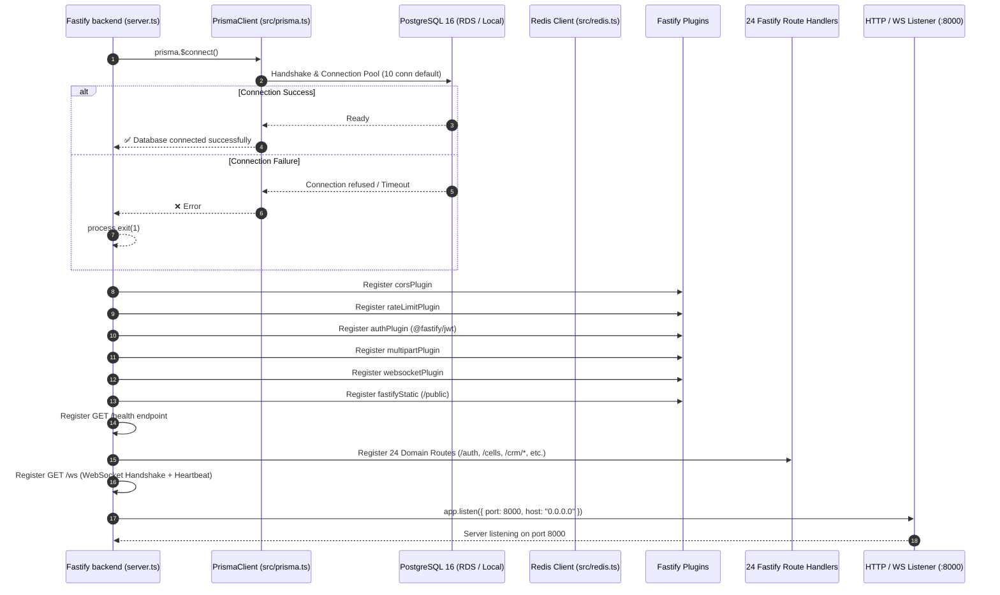

# KYRA ZAM 2.0 — Comprehensive Repository Audit Report

**Document Reference**: `docs/audit/REPOSITORY_AUDIT.md`  
**Execution Phase**: Phase 1 — Complete Codebase Discovery  
**Author**: Principal Software Architect & DevOps Lead  
**Repository**: `https://github.com/growphil/kyra-zam.git`  
**Audited Commit**: `5d8f64322191cd9cc4207e077a12463082f04548` (branch: `main`)  
**Audit Date**: October 2026  

---

## 1. Executive Summary

KYRA ZAM 2.0 is a specialized Enterprise Resource Planning (ERP) and Manufacturing Execution System (MES) tailored for Lithium-ion battery pack manufacturing, assembly, quality control (QC), grading, dispatch, sales, warranty tracking, and service workflows.

The repository comprises:
1. **Backend**: Node.js 20 runtime with Fastify v4, Prisma ORM v5.22.0, and PostgreSQL 16.
2. **Frontend**: Next.js 15.0.0 (React 19, Tailwind CSS v4, Zustand, TanStack Query/Table) intended for Vercel deployment.
3. **Sidecar Service**: Python 3.11 with FastAPI, Pandas, and Rapidfuzz for high-throughput cell grading, IR (Internal Resistance)/AH (Ampere-Hour) capacity report parsing, and cell grouping algorithm execution.
4. **Cache & In-Memory Store**: Redis 7 for queuing and transient session coordination.
5. **Database**: PostgreSQL 16 hosted on AWS RDS (`kyra-zam-db`), containing 98 models and 44 domain enums.

During Phase 1 discovery, **no application code was modified, no migrations were executed on production RDS, and no AWS resources were altered**. The repository was exhaustively analyzed across all layers.

---

## 2. Actual System Architecture

```mermaid
flowchart TD
    subgraph Client Layer
        A[Web Browser / Shop Floor Terminal]
        B[Mobile / Handheld Scanner]
    end

    subgraph Edge & Hosting Layer
        C[Vercel Edge Network] -->|Hosts| D[Next.js 15 Frontend<br/>Port 3000 / SSR & Static]
    end

    subgraph AWS VPC (ap-south-1)
        subgraph Compute Layer (EC2 / ECS Fargate)
            E[Nginx Reverse Proxy / Port 80, 443]
            F[KYRA ZAM Backend<br/>Fastify 4 / Port 8000]
            G[Python AH/IR Sidecar<br/>FastAPI / Port 8001]
            H[Redis 7<br/>Port 6379]
        end

        subgraph Storage & Managed Services
            I[(AWS RDS PostgreSQL 16<br/>kyra-zam-db)]
            J[AWS S3 Bucket<br/>kyrazam-production-files]
        end
    end

    A -->|HTTPS| C
    B -->|HTTPS| C
    A -->|REST API / WSS| E
    B -->|REST API / WSS| E
    D -->|API Proxy / Direct API| E
    E -->|HTTP :8000| F
    F -->|HTTP :8001| G
    F -->|TCP :6379| H
    F -->|Prisma TCP :5432| I
    F -->|AWS SDK S3| J
```

### Component Breakdown & Runtimes

| Component | Path in Repository | Primary Technologies | Runtime / Version | Ports |
|---|---|---|---|---|
| **Backend** | `/backend` | Fastify 4, Prisma 5.22, Zod, bcryptjs, Axios, ExcelJS, PDFKit | Node.js 20 Alpine | `8000` |
| **Frontend** | `/frontend` | Next.js 15.0.0, React 19.0.0, Tailwind CSS v4, Lucide, Framer Motion | Node.js 20 / Next.js | `3000` |
| **Sidecar** | `/sidecar` | FastAPI 0.111.0, Uvicorn 0.29.0, Pandas, Rapidfuzz, OpenPyXL | Python 3.11 Slim | `8001` |
| **Database** | `/backend/prisma` | PostgreSQL 16 RDS (`kyra-zam-db`), 98 tables, 44 enums | PostgreSQL 16 | `5432` |
| **In-Memory** | N/A (Docker Compose) | Redis 7 Alpine | Redis 7 | `6379` |
| **Infrastructure** | `/aws`, `/docker-compose*.yml` | Docker Compose, AWS ECS Fargate Task Definition, GitHub Actions | Multi-stage Docker | N/A |

---

## 3. Component Responsibilities & Code Map

### 3.1 Backend Domain Modules (`backend/src/routes`)

| Route Module | URL Prefix | Size | Core Business Responsibilities |
|---|---|---|---|
| `auth.ts` | `/auth` | 4.3 KB | User login, JWT generation, composite refresh token lifecycle, `/me` profile |
| `admin.ts` | `/admin` | 105.9 KB | System configuration, user administration, role assignment, audit logs, tenant settings |
| `production.ts` | `/crm/production` | 106.6 KB | Work orders, shop floor routing, BOM consumption, station transitions, stage tracking |
| `inventory.ts` | `/inventory` | 53.4 KB | Material stock management, transactions, row-level locked reservations (`FOR UPDATE`), locations |
| `service.ts` | `/service` | 59.5 KB | RMA intake, ticket workflows, repair diagnosis, replacement dispatch, warranty lookups |
| `finance.ts` | `/crm/finance` | 49.5 KB | Customer ledger, sales invoices, receipts, overdue aging, financial clearance checks |
| `packing.ts` | `/packing`, `/crm/packing` | 49.4 KB | Packing order creation, cartonization, shipping labels, QR verification |
| `quality.ts` | `/crm/quality` | 46.6 KB | Quality inspection plans, cell testing checkpoints, Non-Conformance Reports (NCR) |
| `testing.ts` | `/testing` | 38.8 KB | Machine report intake, cell grading coordination, delegation to Python sidecar |
| `quotations.ts` | `/crm/quotations` | 36.4 KB | Sales quotations, revisions, discount approval hierarchies, margin calculations |
| `procurement.ts` | `/crm/procurement` | 35.2 KB | Purchase requisitions, RFQs, Purchase Orders (PO), GRN inward validation |
| `sales.ts` | `/sales` | 34.6 KB | CRM leads, opportunities, customer accounts, sales executive assignments |
| `cells.ts` | `/cells` | 32.4 KB | Raw cell ingestion, lot tracing, IR/AH grading parameters, bin assignments |
| `pax.ts` | `/pax` | 31.9 KB | Battery pack builds, pack serial numbers, cell assembly mapping, end-of-line tests |
| `crm.ts` | `/crm` | 30.9 KB | Customer contacts, support cases, field logs, CRM dashboard metrics |
| `salesOrders.ts` | `/crm/sales-orders` | 23.7 KB | Confirmed sales orders, payment milestone tracking, financial clearance flag |
| `dispatch.ts` | `/crm/dispatch` | 21.7 KB | Dispatch orders, shipping gate passes, financial clearance enforcement, delivery notes |
| `hr.ts` | `/hr`, `/crm/hr` | 67.5 KB | Employee directories, shift rosters, attendance records, leave approvals, payroll |
| `repair.ts` | `/repair` | 14.3 KB | Defective battery pack disassembly, cell replacement, re-testing loops |
| `reports.ts` | `/reports` | 14.3 KB | Shop-floor throughput, scrap summaries, production yield, export utilities |
| `stations.ts` | `/crm/stations` | 8.8 KB | Physical workstation definitions, station sequence, operator assignment |
| `scrap.ts` | `/scrap` | 8.3 KB | Material and cell scrap authorization, segregation, disposal certificates |
| `warranty.ts` | `/crm/warranty` | 7.1 KB | Battery warranty registration, activation checks (`SOLD_TO_CUSTOMER`), claim validation |
| `bom.ts` | `/bom` | 6.8 KB | Bill of Materials management, component revisioning, assembly tree mapping |

### 3.2 Services & Integrations (`backend/src/services`)

- `audit.service.ts`: Structured audit trail creation with user ID and change payload.
- `cell.service.ts`: Cell lot ingestion, validation, and status transitions (`IN_STOCK` -> `TESTED` -> `RESERVED` -> `ASSEMBLED`).
- `disassembly.service.ts`: Controlled dismantling of rejected packs, recycling healthy cells.
- `scrapWorkflowEngine.ts`: State machine for scrap approvals, disposal, and inventory de-allocation.
- `serviceWorkflowEngine.ts`: Service ticket state machine (`INTAKE` -> `DIAGNOSTIC` -> `REPAIR` -> `CLOSED`).
- `sidecar.service.ts`: HTTP client interface communicating with FastAPI sidecar (`/process-report`, `/form-groups`) with 3 retry attempts.
- `storage.service.ts`: Hybrid file storage driver (supports local filesystem `./public/uploads` or AWS S3 via `@aws-sdk/client-s3`).

### 3.3 Python Sidecar (`sidecar/`)

- `main.py`: FastAPI server running on port `8001`.
- `processor.py`: Parses CSV and Excel files containing machine test data; cleans and normalizes serial numbers; runs fuzzy matching against known database serials using Rapidfuzz; performs battery cell grouping based on Ampere-Hour (AH) and Internal Resistance (IR) tolerance bands.
- `qc_rules.py`: Hardcoded and dynamic boundary rules for cell rejection (voltage limits, IR delta, capacity thresholds).

### 3.4 Frontend Modules (`frontend/src/app/[role]`)

The Next.js 15 client dynamically routes users by their active assigned role:
- Includes 28 dedicated operational sub-modules: `admin`, `admin-settings`, `assy`, `bom`, `cells`, `crm`, `dispatch`, `finance`, `finished-goods`, `hr`, `inventory`, `inward`, `management`, `packing`, `pax`, `pax-testing`, `procurement`, `production`, `qc-retest`, `quality`, `repair`, `reports`, `sales`, `scrap`, `service`, `supervisor`, `testing`, `warranties`.

---

## 4. Application Startup Flow



---

## 5. Database Connectivity & Migration Strategy

### 5.1 Architecture & Schema State

- **ORM**: Prisma ORM locked to version `5.22.0`.
- **Target Database**: PostgreSQL 16 (`kyra-zam-db.czes2c8i214u.ap-south-1.rds.amazonaws.com`).
- **Network Constraint**: The RDS instance is located inside an AWS VPC with private IP `172.31.0.62`. It is strictly unreachable from public external IP addresses / local Wi-Fi. Access is only possible from within the AWS VPC (e.g. from the production EC2 instance).
- **Client Output**: Custom location configured in `backend/prisma/schema.prisma` (`output = "../src/generated/client"`).

### 5.2 Chronological Migration Log & Root Cause Analysis of Previous Failure

| Index | Migration Directory | SQL File Summary | Verification Status |
|---|---|---|---|
| 1 | `20260429104211_init` | Initial base tables (User, Cell, Pax, Inventory, etc. — 12 tables) | Applied |
| 2 | `20260504052119_fix_user_schema` | Added `roles` enum array and user fields | Applied |
| 3 | `20260825160000_add_enterprise_schema` | **Added 86 enterprise models & 40 enums** (Work orders, Quotations, Finance, HR, BOM, Quality, etc.) | Created & Verified |
| 4 | `20260825165600_add_hardening_indexes` | High-performance B-tree and composite indexes on enterprise tables | Created & Verified |
| 5 | `20260825174700_add_work_order_scheduling` | Work order priority, station constraints, shift scheduling columns | Created & Verified |
| 6 | `20260825181400_add_work_order_execution` | Execution logs, downtime records, station operator associations | Created & Verified |

#### Root Cause of the Previous RDS Error (P3018):
1. In August 2026, 86 models were added to `backend/prisma/schema.prisma` without running `prisma migrate dev`.
2. Developer created migration `20260825165600_add_hardening_indexes` attempting to add indexes onto tables (`SalesOrder`, `DispatchOrder`, `InventoryItem`, `WorkOrder`, etc.) that did not exist in the database!
3. Running `prisma migrate deploy` against RDS failed with Prisma Error code `P3018`: `relation "SalesOrder" does not exist`.
4. Migration `20260825160000_add_enterprise_schema` has now been generated and committed to `origin/main` at commit `5d8f64322191cd9cc4207e077a12463082f04548`.
5. On a clean test database (`kyrazam_fresh_test`), running all 6 migrations sequentially from scratch resulted in **98 tables created, 44 enums created, and 0.00% schema drift** when checked against `schema.prisma` with `prisma migrate diff --exit-code`.
6. On production RDS, migration `20260825165600_add_hardening_indexes` is currently recorded in `_prisma_migrations` as failed or partially applied. Because `20260825160000_add_enterprise_schema` has an earlier timestamp, running `prisma migrate deploy` directly will be blocked by Prisma's migration history verification. A safe, controlled `prisma migrate resolve` sequence will be required during deployment.

---

## 6. Authentication & Authorization Architecture

### 6.1 Authentication Mechanism
- Fastify JWT plugin (`@fastify/jwt`) with a shared secret (`process.env.JWT_SECRET`).
- Passwords hashed using `bcryptjs` (salt rounds: 10).
- Composite refresh tokens formatted as `${userId}:${rawRefreshToken}` stored in PostgreSQL table `RefreshToken` with `tokenHash` (bcrypt) and `expiresAt` (90 days).

### 6.2 Authorization Mechanism
- Role-based access control (`requireRoles(...)` middleware in `backend/src/middleware/rbac.ts`).
- 16 distinct role definitions: `SUPERADMIN`, `ADMIN`, `INVENTORY_MANAGER`, `TEST_ENGINEER`, `ASSEMBLY_TECHNICIAN`, `PAX_TEST_ENGINEER`, `SUPERVISOR`, `SALES_EXECUTIVE`, `ACCOUNTANT`, `PURCHASE_MANAGER`, `MARKETING_MANAGER`, `QC`, `PACKING_OPERATOR`, `PACKING`, `SELLER`, `HR_PAYROLL`.
- Frontend role enforcement is handled via Next.js middleware (`frontend/src/middleware.ts`) and dynamic router `/[role]`.

---

## 7. Build and Test Configuration

### 7.1 Backend
- **Build**: `tsc` (compiles TypeScript from `src/` to `dist/`).
- **Dependencies**: Managed by `npm`. Lockfile `package-lock.json` is present.
- **Test Suite**: **None configured**. `package.json` contains no `"test"` script. No Jest, Mocha, or Vitest configuration exists.
- **Manual Verification Scripts**: `src/scripts/test-schema-integrity.ts` verifies Prisma client relations and 10 domain queries.

### 7.2 Frontend
- **Build**: `next build`.
- **Lint**: `next lint`.
- **Next.js Config**: `frontend/next.config.ts` currently has `eslint: { ignoreDuringBuilds: true }` and `typescript: { ignoreBuildErrors: true }`.

### 7.3 Sidecar
- **Dependencies**: Managed via `requirements.txt` (FastAPI, Uvicorn, Pandas, Rapidfuzz, OpenPyXL).
- **Container Build**: Multi-stage/single-stage Dockerfile based on `python:3.11-slim`.

---

## 8. Comprehensive Findings & Classification

In strict adherence to the audit mandate, every finding below is classified into one of the required categories:
- **Confirmed defect**
- **Security risk**
- **Missing implementation**
- **Improvement opportunity**
- **Unverified assumption**

### 8.1 Security Risks

| ID | Finding | Classification | Evidence | Impact |
|---|---|---|---|---|
| **SEC-01** | **Dangerous User Role Fallback / Impersonation in Auth Plugin & RBAC** | **Security risk** | `backend/src/plugins/auth.ts` (L47–55), `backend/src/middleware/rbac.ts` (L32–40) | If a token is presented with an invalid or deleted user ID, the code executes `prisma.user.findFirst({ where: { roles: { hasSome: payload.roles }, isActive: true } })`. This logs the request in as the *first* active user with that role (e.g. an arbitrary Superadmin), allowing privilege escalation and account impersonation. |
| **SEC-02** | **Wildcard Role Subscription for Unauthenticated WebSocket Connections** | **Security risk** | `backend/src/server.ts` (L126–138) | In `/ws`, if JWT verification fails or is absent, the connection defaults to `userId: "guest_user"` with **all 10 system roles** assigned: `["SUPERADMIN", "ADMIN", "INVENTORY_MANAGER", ...]`. Any unauthenticated WebSocket client receives all live broadcast events, including confidential sales and finance events. |
| **SEC-03** | **JWT Bearer Token Accepted via URL Query Parameter** | **Security risk** | `backend/src/plugins/auth.ts` (L29–32), `backend/src/middleware/rbac.ts` (L13–16), `backend/src/server.ts` (L121–124) | Query parameter `?token=...` is parsed and assigned to `request.headers.authorization`. JWT tokens passed in URL parameters leak into HTTP access logs, proxy logs, browser histories, and referer headers. |
| **SEC-04** | **Permissive CORS Configuration with Credentials Enabled** | **Security risk** | `backend/src/plugins/cors.ts` (L6–9) | `fastifyCors` is configured with `origin: true` and `credentials: true`. This reflects any requesting origin and permits cross-origin credentialed requests from any third-party malicious website. |
| **SEC-05** | **Excessive Access Token Expiry (365 Days)** | **Security risk** | `backend/src/routes/auth.ts` (L24) | Access tokens are issued with `expiresIn: "365d"`. While `.env` sets `JWT_EXPIRY="60m"`, the code hardcodes 365 days. If an access token is compromised, it cannot be revoked until a year later. |
| **SEC-06** | **Insecure Default Secret Fallback** | **Security risk** | `backend/src/plugins/auth.ts` (L23) | `process.env.JWT_SECRET || "super-secret-key-kyra-zam-2026"`. If the environment variable fails to load, the backend falls back to a publicly visible static secret. |

### 8.2 Confirmed Defects

| ID | Finding | Classification | Evidence | Impact |
|---|---|---|---|---|
| **DEF-01** | **Missing Queue Worker Script Referenced in Package Manifest** | **Confirmed defect** | `backend/package.json` (L14), `backend/src/queues/worker.ts` | `npm run worker` points to `ts-node src/queues/worker.ts`, but directory `backend/src/queues` does not exist on disk. Running this command throws `MODULE_NOT_FOUND`. |
| **DEF-02** | **Prisma 6 Configuration File Present in Prisma 5 Project** | **Confirmed defect** | `backend/prisma.config.ts`, `backend/package.json` (L25, L48) | `prisma.config.ts` imports `{ defineConfig } from "prisma/config"`. In Prisma 5.22.0, `prisma/config` does not exist. While Prisma 5 ignores this file during standard CLI calls, any tooling that loads it fails with module resolution errors. |
| **DEF-03** | **No Refresh Token Rotation on `/auth/refresh`** | **Confirmed defect** | `backend/src/routes/auth.ts` (L55–91) | Refreshing an access token does not rotate the refresh token or update `revokedAt`. An attacker with a captured refresh token can generate fresh access tokens indefinitely for 90 days. |
| **DEF-04** | **Next.js Error Suppression Masking Build Issues** | **Confirmed defect** | `frontend/next.config.ts` (L5–10) | `ignoreBuildErrors: true` and `ignoreDuringBuilds: true` are enabled in Next.js config, allowing broken TypeScript code or lint violations to pass silently into production bundles. |

### 8.3 Missing Implementations

| ID | Finding | Classification | Evidence | Impact |
|---|---|---|---|---|
| **MIS-01** | **No Automated Unit or Integration Test Suite in Backend** | **Missing implementation** | `backend/package.json`, `backend/src` | No automated tests exist for business logic, inventory locking, financial clearance checks, or dispatch rules. All verification currently relies on manual scripts. |
| **MIS-02** | **Distributed Rate Limiting via Redis Not Active** | **Missing implementation** | `backend/src/plugins/rateLimit.ts` | Fastify rate limiter uses default in-memory store. In a multi-container deployment, rate limits are not shared across instances. |
| **MIS-03** | **BullMQ Background Task Architecture Unused** | **Missing implementation** | `backend/package.json` (L29), `backend/src/` | `bullmq` is listed as a production dependency, but no queues, workers, or job dispatchers are implemented in the codebase. |

### 8.4 Improvement Opportunities

| ID | Finding | Classification | Evidence | Impact |
|---|---|---|---|---|
| **IMP-01** | **Strict Origin Whitelisting in CORS** | **Improvement opportunity** | `backend/src/plugins/cors.ts` | Replace `origin: true` with an explicit list of allowed domains (e.g. Vercel production frontend domain, localhost for development). |
| **IMP-02** | **Sync JWT Expiry with Environment Variables** | **Improvement opportunity** | `backend/src/routes/auth.ts` | Utilize `process.env.JWT_EXPIRY` (defaulting to 15m or 60m) instead of hardcoding 365 days. |
| **IMP-03** | **Add Automated Regression Test Suite** | **Improvement opportunity** | `backend/package.json` | Introduce Vitest or Jest with integration tests targeting critical business rules (inventory stock safety, financial clearance, warranty validation). |

### 8.5 Unverified Assumptions

| ID | Finding | Classification | Evidence | Impact |
|---|---|---|---|---|
| **UNV-01** | **Actual RDS Migration History State on AWS** | **Unverified assumption** | `backend/prisma/migrations` vs AWS RDS `_prisma_migrations` | Because AWS RDS (`172.31.0.62`) is only accessible within the VPC/EC2, the exact current contents of `_prisma_migrations` on RDS cannot be queried from this local workstation. It is assumed based on project context that `20260825165600` failed and `20260825160000` is pending. |
| **UNV-02** | **Production EC2 Docker Compose vs ECS Fargate Deployment** | **Unverified assumption** | `docker-compose.prod.yml` vs `.github/workflows/deploy-backend-aws.yml` | The repository contains both a Docker Compose configuration for EC2 and an ECS task definition (`aws/ecs-task-definition.json`) triggered by GitHub Actions. The active target must be confirmed before release. |

---

## 9. Potential Regressions and Backward-Compatibility Risks

1. **Tightening Auth Fallback (SEC-01)**:
   - *Risk*: If existing frontend sessions rely on stale user IDs from a previous database reseed, removing the fallback will invalidate their session and require them to log in again.
   - *Mitigation*: This is expected and desirable security behavior. Users simply log in once to obtain a valid composite session.
2. **Shortening Access Token Expiry (SEC-02/SEC-05)**:
   - *Risk*: If frontend auto-refresh is not firing seamlessly, users might see token expiration errors.
   - *Mitigation*: Ensure frontend Axios interceptor correctly handles `401 Unauthorized` by calling `/auth/refresh` with stored refresh token.
3. **Database Migration Resolution on Production RDS**:
   - *Risk*: Running `prisma migrate deploy` directly against RDS without resolving the failed `20260825165600` entry will abort with an error.
   - *Mitigation*: Follow a controlled, zero-data-loss execution sequence: resolve the failed migration status via `prisma migrate resolve --applied "20260825160000_add_enterprise_schema"`, then deploy remaining migrations.
4. **Removing Next.js Error Suppression**:
   - *Risk*: Disabling `ignoreBuildErrors` might reveal latent TypeScript errors in edge-case frontend components.
   - *Mitigation*: Run `tsc --noEmit` on the frontend codebase and fix any underlying type errors before enabling strict checking in `next.config.ts`.

---

## 10. Conclusion & Phase 1 Sign-Off

The repository audit has successfully mapped the full architecture, identified the root cause of previous database failures, confirmed zero schema drift on clean migrations, and pinpointed critical security vulnerabilities in the authentication and authorization layer.

**Current Codebase State**:
- **Source Code**: Unmodified in Phase 1.
- **Production RDS**: Untouched; zero modifications made.
- **Local Clean Verification**: 100% verified (98 tables, 44 enums, 0 drift).
- **Audit Deliverable**: `docs/audit/REPOSITORY_AUDIT.md` completed.

Phase 1 is complete. We are ready to proceed to Phase 2 (Requirements Traceability) upon user confirmation.
