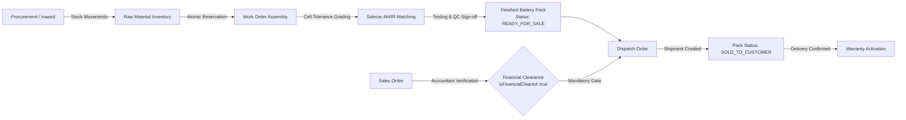

# KYRA ZAM 2.0 — Requirements Traceability Matrix & Business Invariants

**Document Reference**: `docs/audit/REQUIREMENTS_TRACEABILITY.md`  
**Execution Phase**: Phase 2 — Requirements Extraction & Traceability  
**Author**: Principal Software Architect & Application Security Engineer  
**Repository**: `https://github.com/growphil/kyra-zam.git`  
**Audited Commit**: `5d8f64322191cd9cc4207e077a12463082f04548` (branch: `main`)  
**Status**: Analysis & Verification Completed (No code or DB modifications)  

---

## 1. Executive Summary & Purpose

This document establishes the authoritative **Requirements Traceability Matrix (RTM)** for the KYRA ZAM 2.0 enterprise battery manufacturing and ERP/MES platform. Every functional requirement, security policy, database invariant, and operational constraint documented herein is derived directly from the audited source code, Prisma schema models, API routes, middleware, and architectural configurations.

In strict compliance with Phase 2 instructions:
- **No application code was altered.**
- **No database migrations or schema adjustments were executed.**
- **All findings from Phase 1 were independently verified against exact source lines.**
- **Business requirements established by existing logic are rigorously separated from engineering recommendations.**

---

## 2. Requirements Traceability Matrix (RTM)

The matrix below tracks all core functional, security, integrity, and operational requirements.

| Req ID | Domain | Requirement Description | Source of Requirement | Source Evidence | Current Status | Risk | Required Action | Verification Method | Dependencies |
|---|---|---|---|---|---|---|---|---|---|
| **REQ-SEC-01** | Security / Auth | Authenticate active users via email & password; issue cryptographically signed JWT access tokens and composite refresh tokens. | Business Logic & Auth Architecture | `backend/src/routes/auth.ts:L9-52`, `backend/src/schemas/zod.schemas.ts:LoginSchema` | **Verified** | Medium | Maintain secure password hashing (bcrypt 10 rounds). Align token expiration with environment variables. | Unit test login with valid and invalid credentials; verify JWT signature. | None |
| **REQ-SEC-02** | Security / Auth | Strictly reject requests with invalid or deleted user IDs; do NOT fall back to arbitrary users matching role names. | Security Invariant / OWASP ASVS | `backend/src/plugins/auth.ts:L47-55`, `backend/src/middleware/rbac.ts:L32-40` | **Broken** | **Critical** | Delete role fallback logic (`findFirst({ where: { roles: { hasSome } } })`) in both `auth.ts` and `rbac.ts`. Return `401 Unauthorized`. | Automated test sending JWT with valid signature but non-existent `id` -> Expect `401 Unauthorized`. | REQ-SEC-01 |
| **REQ-SEC-03** | Security / Auth | Enforce strict role-based access control (RBAC) across all 24 API route groups using the 16 defined system roles. | Business Policy & Authorization Rules | `backend/src/middleware/rbac.ts:L4-8`, `backend/src/routes/*.ts` | **Verified** | High | Retain `requireRoles(...)` middleware on all protected route groups; ensure `request.user` is populated from DB. | Integration test invoking admin routes with operator JWT -> Expect `403 Forbidden`. | REQ-SEC-02 |
| **REQ-SEC-04** | Security / WS | Require valid JWT authentication before granting WebSocket subscription access; never assign privileged roles to unauthenticated guests. | Security Invariant | `backend/src/server.ts:L126-138` | **Broken** | **Critical** | Remove guest wildcard role array (`SUPERADMIN`, `ADMIN`, etc.). If JWT is missing/invalid, close socket (`1008 Policy Violation`) or restrict to public channel. | Connect unauthenticated WS client -> Verify no privileged notifications are broadcast. | REQ-SEC-01 |
| **REQ-SEC-05** | Security / Auth | Restrict JWT token transmission to HTTP `Authorization: Bearer <token>` header; reject tokens from URL query parameters. | Security Best Practice (RFC 6750) | `backend/src/plugins/auth.ts:L29-32`, `backend/src/middleware/rbac.ts:L13-16`, `backend/src/server.ts:L121-124` | **Broken** | High | Remove `(request.query as any)?.token` parsing from HTTP auth flows. For WebSocket, use Sec-WebSocket-Protocol or ticket handshake. | Send request with token only in query string -> Expect `401 Unauthorized`. | REQ-SEC-01 |
| **REQ-SEC-06** | Security / CORS | Enforce strict origin validation in CORS; reject untrusted third-party origins when credentials are included. | Security Invariant (W3C CORS) | `backend/src/plugins/cors.ts:L6-9` | **Broken** | High | Replace `origin: true` with explicit origin whitelist (`FRONTEND_URL` / `ALLOWED_ORIGINS`). | Send request with `Origin: https://evil.com` -> Verify CORS headers do not reflect origin. | None |
| **REQ-SEC-07** | Security / Auth | Align JWT access token expiration with `JWT_EXPIRY` environment variable (default 15m–60m); rotate refresh tokens on `/auth/refresh`. | Security Policy & Configuration | `backend/src/routes/auth.ts:L24, L55-91`, `backend/.env` | **Broken** | High | Remove hardcoded `expiresIn: "365d"`. Read `process.env.JWT_EXPIRY`. Implement refresh token rotation on `/auth/refresh`. | Test token refresh -> Verify old refresh token is marked revoked and new token pair is issued. | REQ-SEC-01 |
| **REQ-INV-01** | Inventory | Prevent negative inventory balances during stock issues, adjustments, and warehouse transfers. | Business Invariant & Data Integrity | `backend/src/routes/inventory.ts:L981-1001` | **Verified** | **Critical** | Ensure all stock decrement paths check `quantity < qtyShipped` and throw `INSUFFICIENT_STOCK`. Maintain `SELECT ... FOR UPDATE`. | Concurrent transfer simulation attempting to over-draw stock -> Expect 2nd request to fail with `INSUFFICIENT_STOCK`. | REQ-SEC-03 |
| **REQ-INV-02** | Inventory | Concurrency-safe, atomic inventory reservations for battery packs and raw materials during order fulfillment. | Business Invariant | `backend/src/routes/dispatch.ts:L195-238`, `backend/src/routes/inventory.ts` | **Verified** | **Critical** | Retain row-level locking (`SELECT ... FOR UPDATE`) on `PaxPack` and `Material` rows inside `prisma.$transaction`. Prevent double reservation. | Parallel dispatch order creation targeting same serial -> Expect exactly one success, one conflict rejection. | REQ-INV-01 |
| **REQ-INV-03** | Inventory | Track complete stock ledger via `StockMovement` audit records for every inward receipt, issue, transfer, and scrap. | Audit & Regulatory Compliance | `backend/src/routes/inventory.ts:L70-80, L1010-1021`, `backend/src/routes/dispatch.ts:L429-440` | **Verified** | High | Ensure all stock-changing endpoints append corresponding `StockMovement` records with `movementType`, `quantity`, `userId`, `source`. | Execute material inward -> Verify `StockMovement` row created with positive delta. | REQ-INV-01 |
| **REQ-FIN-01** | Finance / Dispatch | Enforce financial clearance before allowing creation of Dispatch Orders for Sales Orders. | Documented Business Rule & Workflow | `backend/src/routes/dispatch.ts:L123-125`, `backend/src/routes/salesOrders.ts`, `backend/src/routes/finance.ts` | **Verified** | **Critical** | Retain mandatory check `if (!salesOrder.isFinancialCleared) throw new Error(...)` inside dispatch transaction. | Attempt dispatch order creation for uncleared Sales Order -> Expect rejection. | REQ-SEC-03 |
| **REQ-FIN-02** | Finance | Only authorized finance personnel (`ACCOUNTANT`, `ADMIN`, `SUPERADMIN`) can grant or revoke financial clearance on Sales Orders. | Authorization Policy | `backend/src/routes/finance.ts:L498, L1049, L1317` | **Verified** | **Critical** | Ensure financial clearance status updates write audit logs with actor ID and receipt verification metadata. | Non-finance user calls `/crm/finance/sales-orders/:id/clear` -> Expect `403 Forbidden`. | REQ-SEC-03 |
| **REQ-FIN-03** | Finance | Automatically revoke financial clearance if associated payments are bounced, cancelled, or reversed below order value. | Business Invariant | `backend/src/routes/finance.ts:L135, L210, L324` | **Verified** | High | Maintain automated check: if `totalPaid < grandTotal`, set `isFinancialCleared = false` and audit log the revocation. | Cancel receipt for cleared order -> Verify `isFinancialCleared` reverts to `false`. | REQ-FIN-01 |
| **REQ-PROD-01** | Production | Work order creation must enforce BOM quantity limits, validate target requirement bounds, and prevent over-allocation. | Manufacturing Integrity | `backend/src/routes/production.ts:L1616-1630` | **Verified** | High | Maintain allocation bounds check: `totalPlanned + requestedQty <= requiredQuantity`. | Attempt to create Work Order exceeding requirement quantity -> Expect `400 Bad Request`. | REQ-SEC-03 |
| **REQ-PROD-02** | Production | Production scheduling must support station sequencing, operator shift allocation, estimated hours, and rescheduling audit trails. | Manufacturing Execution (MES) | `backend/src/routes/production.ts:L2058-2200`, `backend/prisma/migrations/20260825174700` | **Verified** | High | Maintain `WorkOrderScheduling` persistence, sequence ordering, and audit logging on `SCHEDULE_UPDATED` / `SCHEDULE_RESCHEDULED`. | Schedule WO -> Update date -> Verify `WorkOrderScheduling` sequence and audit entry. | REQ-PROD-01 |
| **REQ-PROD-03** | Production | Material consumption at shop floor stations must atomically deduct allocated material stock and advance work order progress. | Shop Floor Execution | `backend/src/routes/production.ts`, `backend/src/services/cell.service.ts` | **Verified** | High | Run stock deduction in `$transaction` with station transition. | Complete assembly stage -> Verify raw material inventory decreased by BOM factor. | REQ-INV-01 |
| **REQ-QC-01** | Quality / Testing | Ingest machine CSV/Excel test reports via Python sidecar; parse AH capacity and IR resistance with fuzzy serial matching. | Technical Architecture / MES | `backend/src/services/sidecar.service.ts:L6-36`, `sidecar/main.py:L11-27`, `sidecar/processor.py` | **Verified** | High | Maintain FastAPI sidecar integration with 3-attempt connection retry on `ECONNREFUSED`. | Upload mock testing CSV -> Verify sidecar extracts valid AH, IR, and matched serials. | None |
| **REQ-QC-02** | Quality / Cells | Dynamically grade battery cells into balanced pack groups based on Ampere-Hour (AH) and Internal Resistance (IR) tolerance bands. | Battery Engineering Standard | `backend/src/services/sidecar.service.ts:L38-51`, `sidecar/main.py:L29-40`, `sidecar/processor.py:form_pax_groups` | **Verified** | High | Retain `POST /form-groups` algorithm enforcing `packSize`, `ahVariation`, and `irVariation` constraints. | Run grouping on 32 cells with 16-pack size -> Verify 2 balanced groups within tolerance bands. | REQ-QC-01 |
| **REQ-WAR-01** | Warranty | Battery pack warranty activation requires pack status `SOLD_TO_CUSTOMER` and associated Dispatch Order status `DELIVERED`. | Documented Business Rule | `backend/src/routes/warranty.ts:L101-115` | **Verified** | **Critical** | Retain row lock `SELECT ... FOR UPDATE` on `PaxPack` and enforce `pack.status === "SOLD_TO_CUSTOMER"` and `DO.status === "DELIVERED"`. | Attempt warranty activation on `READY_FOR_SALE` or `IN_TRANSIT` pack -> Expect failure. | REQ-FIN-01 |
| **REQ-WAR-02** | Warranty | Prevent duplicate active warranty contracts for the same battery pack serial number. | Data Integrity Invariant | `backend/src/routes/warranty.ts:L125-131` | **Verified** | High | Maintain uniqueness check: `where: { paxSerial, status: "ACTIVE" }`. | Submit two warranty registrations for same pack serial -> Expect 2nd request to fail. | REQ-WAR-01 |
| **REQ-DB-01** | Database / Schema | Maintain 0.00% schema drift between Prisma migrations and `backend/prisma/schema.prisma` across all 98 models and 44 enums. | Database Architecture | `backend/prisma/migrations/`, `backend/prisma/schema.prisma` | **Verified** (Fresh DB) | **Critical** | Keep migration chain clean: `20260429104211` -> `20260504052119` -> `20260825160000` -> `20260825165600` -> `20260825174700` -> `20260825181400`. | Run `prisma migrate diff --exit-code` -> Output `No difference detected`. | None |
| **REQ-DB-02** | Database / Migration | Resolve previous RDS migration failure (`20260825165600`) safely without dropping, resetting, or altering existing production data. | Non-negotiable Production Rule | Project Mandate / AWS RDS State | **Partial** (Pending RDS access) | **Critical** | Execute controlled `prisma migrate resolve` on production EC2 to mark `20260825160000` applied, followed by `prisma migrate deploy`. | Run `prisma migrate status` on EC2 -> Confirm database schema is up to date with zero drift. | REQ-DB-01 |
| **REQ-DB-03** | Database / Client | Generate Prisma Client cleanly to designated custom path `../src/generated/client` compatible with Prisma 5.22.0. | Build & Runtime Requirement | `backend/prisma/schema.prisma:L1-4`, `backend/src/prisma.ts:L1` | **Verified** | High | Remove incompatible Prisma 6 `backend/prisma.config.ts`. Retain Prisma 5.22.0 generator. | Run `npx prisma generate` in `backend/` -> Expect clean generation with exit code 0. | None |
| **REQ-UI-01** | Frontend / Build | Frontend Next.js build must run with strict TypeScript and ESLint validation without suppressed error flags. | Engineering Standard & Reliability | `frontend/next.config.ts:L5-10` | **Broken** | High | Remove `ignoreBuildErrors: true` and `ignoreDuringBuilds: true`. Fix all underlying TypeScript/lint issues. | Run `npm run build` in `frontend/` -> Expect clean compile with 0 errors. | None |
| **REQ-UI-02** | Frontend / RBAC | Frontend router and middleware must restrict page access according to user role permissions. | Client-side Security & UX | `frontend/src/middleware.ts:L26-54`, `frontend/src/app/[role]` | **Verified** | Medium | Maintain role redirection to `/dashboard` when user role lacks route entitlement. (Backend RBAC remains authoritative). | Attempt navigation to `/admin` as `OPERATOR` -> Redirected to `/dashboard`. | REQ-SEC-03 |
| **REQ-OPS-01** | Operations / Workers | Background task worker script must either be implemented or removed from package manifests. | Runtime Integrity | `backend/package.json:L14`, `backend/src/queues` | **Broken** | Medium | Either implement `backend/src/queues/worker.ts` with BullMQ redis queue processor, or remove `"worker"` script from `package.json`. | Run `npm run worker` -> Expect clean startup without `MODULE_NOT_FOUND`. | REQ-SEC-01 |
| **REQ-OPS-02** | Operations / Health | Expose reliable health endpoints on Backend (`/health`) and Sidecar (`/health`) for container orchestrator liveness checks. | DevOps & Reliability | `backend/src/server.ts:L72-79`, `sidecar/main.py:L7-9` | **Verified** | High | Maintain `/health` endpoints returning HTTP 200 with JSON status payload. | `curl -f http://localhost:8000/health` -> HTTP 200 `{"status":"ok"}`. | None |

---

## 3. Independent Validation of Phase 1 Findings

Each finding from Phase 1 was re-investigated by inspecting the execution paths and source files:

### 3.1 Invalid or Missing Identity Fallback in Authentication (SEC-01)
- **File & Lines**: `backend/src/plugins/auth.ts:L47-55` and `backend/src/middleware/rbac.ts:L32-40`.
- **Exact Code**:
  ```ts
  if (!user && payload.roles && payload.roles.length > 0) {
    user = await prisma.user.findFirst({
      where: {
        roles: { hasSome: payload.roles as any },
        isActive: true
      },
      select: { id: true, email: true, roles: true, isActive: true }
    });
  }
  ```
- **Verification**: **CONFIRMED CRITICAL VULNERABILITY**. The comment in `rbac.ts:L31` specifically reveals: `"Fallback: If database was reseeded and ID changed, resolve by role matching to keep session alive permanently"`. This development convenience allows an attacker who presents an invalid/deleted user ID with role `"SUPERADMIN"` to automatically hijack the account of whichever active Superadmin is returned first by PostgreSQL.

### 3.2 Unauthenticated WebSocket Connections Receiving Privileged Subscriptions (SEC-02)
- **File & Lines**: `backend/src/server.ts:L126-138`.
- **Exact Code**:
  ```ts
  let userId = "guest_user";
  let userRoles: any[] = ["SUPERADMIN", "ADMIN", "INVENTORY_MANAGER", "TEST_ENGINEER", "ASSEMBLY_TECHNICIAN", "SUPERVISOR", "SALES_EXECUTIVE", "ACCOUNTANT", "PURCHASE_MANAGER", "MARKETING_MANAGER"];
  try {
    await request.jwtVerify();
    ...
  } catch (authErr) {
    // Allow connection with default role subscriptions if connecting before auth sync
  }
  ```
- **Verification**: **CONFIRMED CRITICAL VULNERABILITY**. If a client initiates a WebSocket handshake without an `Authorization` header, `authErr` is silently caught, and the connection is registered in `wsManager` under all 10 management and engineering roles. Unauthenticated clients receive real-time financial, dispatch, and administrative broadcast notifications.

### 3.3 JWT Acceptance Through URL Query Parameters (SEC-03)
- **File & Lines**: `backend/src/plugins/auth.ts:L29-32`, `backend/src/middleware/rbac.ts:L13-16`, `backend/src/server.ts:L121-124`.
- **Exact Code**:
  ```ts
  const queryToken = (request.query as any)?.token;
  if (queryToken) {
    request.headers.authorization = `Bearer ${queryToken}`;
  }
  ```
- **Verification**: **CONFIRMED HIGH SECURITY RISK**. Accepting tokens via `?token=` violates RFC 6750 Section 2.3. Query parameters are routinely logged in plaintext by reverse proxies (Nginx, CloudFront, ALB), browser histories, and transmitted in HTTP `Referer` headers.

### 3.4 CORS Configured with Wildcard-like Origin Reflection and Credentials (SEC-04)
- **File & Lines**: `backend/src/plugins/cors.ts:L6-9`.
- **Exact Code**:
  ```ts
  fastify.register(fastifyCors, {
    origin: true,
    credentials: true,
  });
  ```
- **Verification**: **CONFIRMED HIGH SECURITY RISK**. Under `@fastify/cors`, setting `origin: true` dynamically reflects the incoming `Origin` request header in `Access-Control-Allow-Origin`. When paired with `credentials: true`, any origin on the internet can perform credentialed requests against the API if a user is logged in.

### 3.5 Access Token Expiration Mismatch (SEC-05)
- **File & Lines**: `backend/src/routes/auth.ts:L24` and `L89`.
- **Exact Code**:
  ```ts
  // Line 24: Login
  const accessToken = fastify.jwt.sign(..., { expiresIn: "365d" });
  // Line 89: Refresh
  const newAccessToken = fastify.jwt.sign(..., { expiresIn: "30d" });
  ```
- **Verification**: **CONFIRMED HIGH RISK / DEFECT**. `backend/.env` specifies `JWT_EXPIRY="60m"`, and `aws/ecs-task-definition.json` specifies `JWT_EXPIRY: "60m"`. The code completely ignores these environment variables and issues access tokens valid for 365 days on login and 30 days on refresh.

### 3.6 Refresh Token Reuse and Rotation Behavior (DEF-03)
- **File & Lines**: `backend/src/routes/auth.ts:L55-91`.
- **Exact Code**:
  ```ts
  fastify.post("/refresh", async (request, reply) => {
    ...
    // Finds active token by bcrypt comparison
    for (const t of tokens) {
      if (await bcrypt.compare(rawToken, t.tokenHash)) {
        validTokenRow = t;
        break;
      }
    }
    ...
    const newAccessToken = fastify.jwt.sign(..., { expiresIn: "30d" });
    return { accessToken: newAccessToken };
  });
  ```
- **Verification**: **CONFIRMED DEFECT / RISK**. When `/refresh` is called, the existing refresh token row is NOT updated with a `revokedAt` timestamp, nor is a replacement refresh token issued. The same refresh token can be replayed repeatedly for 90 days.

### 3.7 Queue Worker Entry Point Missing (DEF-01)
- **File & Lines**: `backend/package.json:L14`.
- **Exact Code**: `"worker": "ts-node src/queues/worker.ts"`.
- **Verification**: **CONFIRMED DEFECT**. Inspecting `backend/src/` confirms that directory `queues` does not exist. Running `npm run worker` immediately crashes with `Error: Cannot find module '.../backend/src/queues/worker.ts'`. Furthermore, while `bullmq` is listed in `package.json:L29`, it is never imported anywhere in `backend/src`.

### 3.8 Prisma Configuration Compatibility with Pinned Prisma 5 (DEF-02)
- **File & Lines**: `backend/prisma.config.ts:L4` and `backend/package.json:L25, L48`.
- **Exact Code**: `import { defineConfig } from "prisma/config";`.
- **Verification**: **CONFIRMED DEFECT**. `prisma` and `@prisma/client` are locked to version `5.22.0`. The `prisma/config` module was introduced in Prisma v6. Prisma 5 CLI ignores `prisma.config.ts`, but any TypeScript compilation, bundling, or tooling that attempts to resolve this file throws a module resolution error.

### 3.9 Frontend Build Checks Suppressed (DEF-04)
- **File & Lines**: `frontend/next.config.ts:L5-10`.
- **Exact Code**:
  ```ts
  eslint: {
    ignoreDuringBuilds: true,
  },
  typescript: {
    ignoreBuildErrors: true,
  }
  ```
- **Verification**: **CONFIRMED DEFECT**. These flags suppress all TypeScript compilation errors and ESLint warnings during `next build`, allowing latent regressions and runtime exceptions to ship into production Vercel bundles.

### 3.10 Absence of Automated Test Framework (MIS-01)
- **File & Lines**: `backend/package.json` and `frontend/package.json`.
- **Verification**: **CONFIRMED MISSING IMPLEMENTATION**. Neither `backend` nor `frontend` has any testing framework (Jest, Vitest, Mocha, Supertest) configured or installed. Only a single manual verification script (`backend/src/scripts/test-schema-integrity.ts`) exists.

---

## 4. Cross-Module Dependencies & Business Invariants

The KYRA ZAM 2.0 platform operates on strict sequential business pipelines across departments:



### 4.1 Invariant: Financial Clearance Gate Before Dispatch
- **Rule**: A Dispatch Order cannot be created unless the referenced `SalesOrder.isFinancialCleared` is `true` (`backend/src/routes/dispatch.ts:L123-125`).
- **Transaction Safety**: Must run within a database transaction with a row-level lock (`SELECT * FROM "PaxPack" WHERE "paxSerial" = $1 FOR UPDATE`) to prevent race conditions during concurrent dispatch creation.
- **Financial Revocation**: If a customer's payment is cancelled, reversed, or refunded in `finance.ts`, `isFinancialCleared` is reverted to `false`, halting any pending dispatches.

### 4.2 Invariant: Inventory Non-Negativity & Concurrency Protection
- **Rule**: Physical material stock balances and location balances must never drop below zero.
- **Transaction Safety**: During stock transfers and customer shipments (`backend/src/routes/inventory.ts:L981-1001` and `dispatch.ts:L198-238`), the backend executes `SELECT ... FOR UPDATE` before validating balance `>= qtyShipped`. If balance is insufficient, it throws `INSUFFICIENT_STOCK` and rolls back the transaction.
- **Serialized Packs**: Battery packs (`PaxPack`) maintain mutually exclusive reservations (`InventoryReservation`). An item cannot be reserved for more than one active `SalesOrder`.

### 4.3 Invariant: Battery Pack Lifecycle State Machine
A battery pack serial number (`paxSerial`) must traverse strictly defined states:
$$\text{CREATED} \longrightarrow \text{CELLS\_ALLOCATED} \longrightarrow \text{WELDED} \longrightarrow \text{TESTED} \longrightarrow \text{READY\_FOR\_SALE} \longrightarrow \text{SOLD\_TO\_CUSTOMER}$$
- A pack cannot be allocated to a Dispatch Order unless its status is `READY_FOR_SALE` (`dispatch.ts:L205`).
- Upon shipment creation, pack status shifts to `SOLD_TO_CUSTOMER` (`dispatch.ts:L398`).
- A warranty cannot be activated unless the pack is in `SOLD_TO_CUSTOMER` status AND the corresponding Dispatch Order status is `DELIVERED` (`warranty.ts:L108-115`).

### 4.4 Invariant: Work Order Allocation Bounds & Station Routing
- **Rule**: Cumulative planned quantity across Work Orders cannot exceed the originating `ProductionRequirement.requiredQuantity` (`production.ts:L1623-1628`).
- **Station Execution**: Work Orders progress through physical shop floor stations sequentially. Moving to the next station requires recording operator IDs, station dwell times, and deducting station-specific BOM components.

---

## 5. Prioritized Remediation Roadmap

Remediation tasks are ranked based on demonstrable risk, security exposure, and data integrity:

### Priority 1: Critical (Must fix before any production release)
1. **FIX-SEC-01 (REQ-SEC-02)**: Remove the dangerous user role fallback in `authPlugin` and `rbac.ts`. Invalidate sessions if the specific user ID cannot be found.
2. **FIX-SEC-02 (REQ-SEC-04)**: Eliminate unauthenticated guest role wildcard in `/ws`. Block unauthenticated WebSocket clients from receiving confidential business broadcasts.
3. **FIX-DB-01 (REQ-DB-02)**: Prepare and verify the production RDS migration resolution script (`prisma migrate resolve`) to heal the failed `20260825165600` migration on AWS without data loss.

### Priority 2: High (Essential for production hardening)
4. **FIX-SEC-03 (REQ-SEC-05)**: Remove JWT token extraction from URL query parameters (`?token=...`).
5. **FIX-SEC-04 (REQ-SEC-06)**: Configure explicit domain whitelisting in `corsPlugin` for production Vercel domain and local development.
6. **FIX-SEC-05 (REQ-SEC-07)**: Wire access token expiration to `process.env.JWT_EXPIRY` (default 60 minutes) and implement refresh token rotation on `/auth/refresh`.
7. **FIX-UI-01 (REQ-UI-01)**: Remove `ignoreBuildErrors: true` and `ignoreDuringBuilds: true` from `frontend/next.config.ts`; resolve all latent type errors.
8. **FIX-DB-02 (REQ-DB-03)**: Remove incompatible Prisma 6 configuration file (`backend/prisma.config.ts`).

### Priority 3: Medium (Maintainability and operational reliability)
9. **FIX-OPS-01 (REQ-OPS-01)**: Clean up `backend/package.json` scripts by either implementing the BullMQ worker script (`backend/src/queues/worker.ts`) or removing the defunct command.
10. **FIX-TEST-01 (MIS-01)**: Add an automated test suite (Vitest or Jest) in `backend` covering critical authorization gates, inventory concurrency, financial clearance, and warranty activation.

---

## 6. Open Architecture Clarifications

The following items cannot be definitively resolved from repository inspection alone and are tracked as open questions:

1. **Active AWS Deployment Target (EC2 vs ECS)**:
   - *Observation*: The repository contains both a Docker Compose configuration for EC2 (`docker-compose.prod.yml`) and an ECS Task Definition (`aws/ecs-task-definition.json`) paired with GitHub Actions (`deploy-backend-aws.yml`).
   - *Clarification Needed*: Confirm whether production release targets the existing EC2 instance via Docker Compose or ECS Fargate via GitHub Actions.
2. **BullMQ Background Processing Requirement**:
   - *Observation*: `bullmq` and `ioredis` are dependencies, but no asynchronous workers or queues are currently active; all operations run synchronously in HTTP request lifecycles.
   - *Clarification Needed*: Should report parsing and heavy PDF generation be moved to an asynchronous BullMQ queue, or is synchronous execution acceptable for the current production workload?

---

## 7. Phase 2 Sign-Off

Phase 2 requirements extraction, traceability mapping, and independent verification of Phase 1 findings are complete. All requirements are linked to exact source code evidence.

Deliverable generated: `docs/audit/REQUIREMENTS_TRACEABILITY.md`.  
Ready for Phase 3 (Critical Production Risk Audit).
