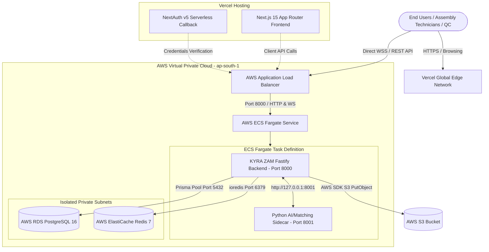

# KYRA ZAM 2.0 — Production Deployment Architecture & Runbook
**Target Infrastructure:** Frontend on **Vercel** | Backend on **AWS (ECS Fargate)** | Sidecar on **AWS (ECS / Co-located Task)**

---

## 1. Executive Summary & Architecture Overview

KYRA ZAM 2.0 is an enterprise battery cell testing, assembly, CRM, and MES (Manufacturing Execution System) platform. It follows a decoupled 3-tier microservice architecture:

| Tier | Component | Technology Stack | Hosting Target | Scaling Strategy |
| :--- | :--- | :--- | :--- | :--- |
| **Frontend** | Client Web App & NextAuth Proxy | Next.js 15, React 19, Tailwind CSS v4, Lucide Icons, TanStack Query | **Vercel** (Global Edge CDN & Serverless) | Auto-scaled globally by Vercel Edge Network |
| **Backend** | Core REST API & Telemetry WebSockets | Node.js 20, Fastify 4, Prisma ORM 5, TypeScript | **AWS ECS Fargate** behind Application Load Balancer (ALB) | Horizontal Pod/Task Autoscaling (Target CPU 70%) |
| **Sidecar** | Data Processing & Matching Engine | Python 3.11, FastAPI, Pandas, TheFuzz, RapidFuzz | **AWS ECS Fargate** (Co-located container or Microservice) | Scales with ECS Task instances |
| **Database** | Primary Relational Storage | PostgreSQL 16 | **AWS RDS PostgreSQL** (Multi-AZ) | Provisioned Storage Auto-scaling |
| **Cache & Pub/Sub** | Realtime Sync & Job Queues | Redis 7 | **AWS ElastiCache for Redis** | Cluster mode enabled / Replication Group |
| **File Storage** | Battery Test Reports & Attachments | S3 Object Store | **AWS S3** (`kyrazam-production-files`) | S3 Standard / Infrequent Access |

---

## 2. High-Level Architecture Diagram



---

## 3. Comprehensive File & Folder Structure Analysis

### 3.1 Root Repository Structure
```
KYRA ZAM 2.O/
├── .github/
│   └── workflows/
│       ├── deploy-frontend-vercel.yml   # Automatic GitHub -> Vercel Deployment Action
│       └── deploy-backend-aws.yml        # Automatic Docker build -> AWS ECR -> ECS deploy
├── aws/
│   └── ecs-task-definition.json          # AWS ECS Fargate Production Task Definition
├── backend/                              # Fastify + Prisma + TypeScript REST/WebSocket API
├── frontend/                             # Next.js 15 + React 19 Frontend Web Application
├── sidecar/                              # Python 3.11 + FastAPI Data Normalization & Matching
├── document/                             # Architecture specifications & design standards
├── docker-compose.yml                    # Local full-stack staging orchestration
└── KYRA_ZAM_2.0_UI_UX_Implementation_Tracker.md
```

---

### 3.2 Frontend Architecture (`frontend/`)
The frontend is built on **Next.js 15 (App Router)** with React 19, strict TypeScript, and Tailwind CSS v4.

```
frontend/
├── .env.example                          # Environment variable template
├── .env.local                            # Local development environment (ignored in git)
├── vercel.json                           # Vercel deployment & security headers config
├── next.config.ts                        # Next.js 15 compilation parameters
├── package.json                          # Frontend dependencies & build scripts
├── tsconfig.json                         # Path aliasing (@/* -> src/*)
├── public/                               # Static icons, brand graphics, QR assets
└── src/
    ├── auth.ts                           # NextAuth v5 credentials configuration
    ├── middleware.ts                     # RBAC Edge Middleware protecting routes
    ├── app/                              # Next.js App Router root
    │   ├── [role]/                       # Dynamic role-based workspaces
    │   │   ├── admin/                    # System administration console
    │   │   ├── crm/                      # Customer & Lead Relationship Management
    │   │   ├── inventory/                # Cell & pack raw material tracking
    │   │   ├── pax-testing/              # Pack testing & telemetry dashboards
    │   │   ├── production/               # Assembly line & MES workflow management
    │   │   ├── quality/                  # Inward & Outward QC testing suites
    │   │   └── ...                       # Sales, Finance, HR, BOM, Repair, Warranties
    │   ├── api/auth/[...nextauth]/route.ts # NextAuth Serverless API handler
    │   ├── layout.tsx                    # Root HTML layout with fonts & providers
    │   └── page.tsx                      # Root redirect logic
    ├── components/                       # Reusable UI component library
    ├── hooks/                            # Custom React hooks (telemetry, query, debouncing)
    ├── lib/
    │   └── api.ts                        # Axios client with dynamic environment resolution
    └── store/                            # Zustand stores for reactive client state
```

#### Frontend Deployment Highlights for Vercel:
- **Build Command:** `next build`
- **Output Directory:** `.next`
- **Node.js Version:** 20.x
- **Key Environment Variables Required on Vercel Dashboard:**
  - `NEXT_PUBLIC_API_URL`: Direct HTTPS address of the AWS ALB (e.g., `https://api.kyrazam.com`)
  - `NEXT_PUBLIC_WS_URL`: Direct WSS address of the AWS ALB (e.g., `wss://api.kyrazam.com`)
  - `NEXTAUTH_URL`: Canonical public URL of frontend (e.g., `https://app.kyrazam.com`)
  - `NEXTAUTH_SECRET`: Cryptographically strong 64-byte random string (`openssl rand -hex 32`)
  - `AUTH_SECRET`: Same value as `NEXTAUTH_SECRET` for NextAuth v5 compatibility

---

### 3.3 Backend Architecture (`backend/`)
The backend is a high-performance **Fastify 4** Node.js server written in TypeScript, managing relational entities via **Prisma ORM**, streaming real-time telemetry via **WebSocket (`/ws`)**, and delegating cell-matching computations to the Sidecar.

```
backend/
├── Dockerfile                            # Multi-stage production container build
├── .dockerignore                         # Docker context exclusions
├── package.json                          # Backend scripts (build, migrate, seed, start)
├── tsconfig.json                         # Target ES2020 / CommonJS build configuration
├── nodemon.json                          # Dev server watcher
├── prisma/
│   ├── schema.prisma                     # Complete multi-table database schema
│   ├── migrations/                       # Deterministic SQL migration history
│   └── seed.ts                           # Default user roles & master fixtures
├── public/
│   └── uploads/                          # Fallback local directory for reports
└── src/
    ├── server.ts                         # Application entrypoint, /health, /ws, route bindings
    ├── prisma.ts                         # Singleton PrismaClient instance
    ├── redis.ts                          # Singleton ioredis client
    ├── plugins/                          # Fastify plugins (Auth, CORS, Multipart, Static, WS)
    ├── routes/                           # Modular endpoints (auth, cells, crm, inventory, etc.)
    ├── services/
    │   ├── sidecar.service.ts            # HTTP client calling Python sidecar
    │   ├── storage.service.ts            # Dual-driver S3 / Local upload service
    │   └── ...                           # Workflow engines (scrap, service, disassembly)
    └── websocket/
        └── manager.ts                    # Realtime multi-client WebSocket broker
```

#### Backend AWS ECS Fargate Specifications:
- **Container Port:** `8000`
- **Health Check Endpoint:** `GET /health` (Returns HTTP 200 `{ "status": "ok" }`)
- **WebSocket Protocol:** `ws://.../ws` and `wss://.../ws` (Native Fastify WebSocket)
- **Database Driver:** `@prisma/client` connects directly to AWS RDS PostgreSQL
- **Redis Driver:** `ioredis` connects directly to AWS ElastiCache for Redis

---

### 3.4 Python Sidecar Architecture (`sidecar/`)
The Sidecar handles CPU-intensive data analysis: parsing manufacturer raw test reports (.xlsx, .csv), performing fuzzy serial matching using Levenshtein distance (`TheFuzz` / `RapidFuzz`), and generating optimized battery pack cell groupings based on Ah capacity and IR internal resistance tolerances.

```
sidecar/
├── Dockerfile                            # Python 3.11-slim container spec
├── .dockerignore                         # Exclusion of venv and __pycache__
├── requirements.txt                      # FastAPI, Uvicorn, Pandas, OpenPyXL, RapidFuzz
├── main.py                               # FastAPI application endpoints (/health, /process-report, /form-groups)
├── processor.py                          # Pandas vectorized extraction & fuzzy match engine
└── qc_rules.py                           # Battery cell grading rules (A, B, C, Reject)
```

#### Sidecar AWS Deployment Patterns:
1. **Co-located Container in Same ECS Task (Recommended):**
   - The Backend and Sidecar run as two containers in the **same AWS ECS Task Definition**.
   - Communication happens over `http://127.0.0.1:8001` via the task's shared `awsvpc` loopback interface.
   - **Benefits:** Zero latency, zero additional load balancer cost, sidecar has zero exposure to the internet, and scales 1:1 with backend instances.
2. **Independent Microservice on AWS App Runner / ECS:**
   - Deployed as an internal service behind an AWS Private ALB or Service Connect.
   - Best if sidecar workloads require dedicated GPU/high-compute scaling independent of web traffic.

---

## 4. Step-by-Step Vercel Frontend Deployment

### Step 4.1: Connect Repository to Vercel
1. Log into [Vercel Dashboard](https://vercel.com) and click **Add New... > Project**.
2. Import the Git repository containing KYRA ZAM 2.0.
3. In the project setup wizard:
   - **Root Directory:** Edit to select `frontend`.
   - **Framework Preset:** `Next.js` (automatically detected).
   - **Build Command:** `next build` (default).
   - **Output Directory:** `.next` (default).
   - **Install Command:** `npm install` (default).

### Step 4.2: Configure Production Environment Variables on Vercel
Navigate to **Settings > Environment Variables** and configure:

| Variable Name | Environment | Example Production Value |
| :--- | :--- | :--- |
| `NEXT_PUBLIC_API_URL` | Production, Preview | `https://api.kyrazam.com` |
| `NEXT_PUBLIC_WS_URL` | Production, Preview | `wss://api.kyrazam.com` |
| `NEXTAUTH_URL` | Production | `https://app.kyrazam.com` |
| `NEXTAUTH_SECRET` | Production, Preview | *Generated 64-char hex string* |
| `AUTH_SECRET` | Production, Preview | *Generated 64-char hex string* |

### Step 4.3: Custom Domain & SSL
1. In Vercel Project Settings, go to **Domains**.
2. Add your custom domain: `app.kyrazam.com`.
3. Update your DNS registrar with the CNAME record:
   - Name: `app`
   - Value: `cname.vercel-dns.com`
4. Vercel provisions an automatic SSL/TLS certificate via Let's Encrypt.

---

## 5. Step-by-Step AWS Backend & Sidecar Deployment

### Step 5.1: Amazon ECR Setup (Container Registries)
Create two private repositories in your target AWS region (`ap-south-1`):
```bash
aws ecr create-repository --repository-name kyrazam-backend --region ap-south-1
aws ecr create-repository --repository-name kyrazam-sidecar --region ap-south-1
```

### Step 5.2: AWS RDS PostgreSQL 16 Provisioning
1. Open Amazon RDS Console and create database:
   - **Engine:** PostgreSQL 16.x
   - **Template:** Production (Multi-AZ deployment)
   - **DB Instance Class:** `db.t4g.medium` (or `db.r6g.large` for high volume)
   - **Storage:** 50 GB gp3 with storage autoscaling up to 500 GB
   - **VPC & Subnets:** Place in Private DB Subnets across at least 2 Availability Zones.
   - **Security Group:** Inbound TCP port 5432 permitted ONLY from the ECS Backend Security Group.
   - **Initial Database Name:** `kyrazam`

### Step 5.3: AWS ElastiCache for Redis Provisioning
1. Open Amazon ElastiCache Console:
   - **Cluster Engine:** Redis OSS 7.x
   - **Node Type:** `cache.t4g.medium`
   - **Subnet Group:** Private Cache Subnets
   - **Security Group:** Inbound TCP port 6379 permitted ONLY from the ECS Backend Security Group.

### Step 5.4: Amazon S3 Bucket Provisioning
1. Create bucket: `kyrazam-production-files` in `ap-south-1`.
2. Disable public access (Block *all* public access: ON).
3. Enable Server-Side Encryption with Amazon S3 managed keys (SSE-S3).
4. Configure CORS policy for file viewing:
```json
[
  {
    "AllowedHeaders": ["*"],
    "AllowedMethods": ["GET", "PUT", "HEAD"],
    "AllowedOrigins": ["https://app.kyrazam.com"],
    "ExposeHeaders": ["ETag"]
  }
]
```

### Step 5.5: AWS Secrets Manager Configuration
Store the sensitive credentials in Secrets Manager under `kyrazam/prod/`:
- `kyrazam/prod/database-url`: `postgresql://dbadmin:<PASSWORD>@<RDS_ENDPOINT>:5432/kyrazam?schema=public&sslmode=prefer`
- `kyrazam/prod/redis-url`: `redis://<ELASTICACHE_ENDPOINT>:6379`
- `kyrazam/prod/jwt-secret`: `<SUPER_SECRET_STRING_MIN_32_CHARS>`
- `kyrazam/prod/jwt-refresh-secret`: `<SUPER_SECRET_REFRESH_STRING_MIN_32_CHARS>`

### Step 5.6: Application Load Balancer (ALB) Configuration
1. Create an Internet-facing **Application Load Balancer** in your Public Subnets.
2. Request an SSL certificate in **AWS Certificate Manager (ACM)** for `api.kyrazam.com`.
3. Configure Listeners:
   - **Port 80 (HTTP):** Default action -> Redirect to HTTPS 443 (HTTP 301).
   - **Port 443 (HTTPS):** Attach ACM certificate. Default action -> Forward to Target Group `tg-kyrazam-backend`.
4. Configure Target Group `tg-kyrazam-backend`:
   - **Target type:** IP (required for ECS Fargate `awsvpc` mode)
   - **Protocol:** HTTP Port 8000
   - **Health Check Path:** `/health`
   - **Health Check Interval:** 15 seconds
   - **Healthy Threshold:** 2
   - **Unhealthy Threshold:** 3
   - **Attributes (WebSocket enablement):**
     - Stickiness: Enabled (Load balancer generated cookie, duration 1 day)
     - Deregistration delay: 30 seconds
     - Idle timeout: 300 seconds (allows persistent WebSocket telemetry connections)

### Step 5.7: ECS Cluster & Fargate Service Launch
1. Create an ECS Cluster: `kyrazam-production-cluster`.
2. Register the Task Definition using [`aws/ecs-task-definition.json`](file:///d:/GROWPHIL%20PROJECT/KYRA%20ZAM%202.O/aws/ecs-task-definition.json).
3. Create the ECS Service:
   - **Launch type:** Fargate
   - **Service Name:** `kyrazam-backend-service`
   - **Desired Tasks:** 2 (for High Availability across 2 AZs)
   - **Networking:** Private App Subnets
   - **Security Group:** Inbound TCP 8000 allowed only from ALB Security Group. Outbound: 0.0.0.0/0 via NAT Gateway.
   - **Load Balancer Integration:** Select the ALB and target group `tg-kyrazam-backend`.
   - **Auto Scaling:** Minimum 2, Maximum 10 tasks based on CPU utilization > 70%.

---

## 6. Database Migration Strategy (`Prisma Migrate Deploy`)

In a containerized AWS ECS environment, you must **NEVER** run migrations in application startup code across multiple scaling containers (which causes database race conditions and table locking).

### Recommended Migration Workflow:
Before triggering an ECS service deployment, run a single one-off ECS migration task or execute via CI/CD:
```bash
# Executed via AWS CLI or GitHub Actions
aws ecs run-task \
  --cluster kyrazam-production-cluster \
  --task-definition kyrazam-production-task \
  --launch-type FARGATE \
  --network-configuration "awsvpcConfiguration={subnets=[<PRIVATE_SUBNET_ID>],securityGroups=[<ECS_SG_ID>],assignPublicIp=DISABLED}" \
  --overrides '{
    "containerOverrides": [
      {
        "name": "kyrazam-backend",
        "command": ["npx", "prisma", "migrate", "deploy"]
      }
    ]
  }'
```

---

## 7. Security Best Practices & IAM Policy

### ECS Task Role (`kyrazamEcsTaskRole`)
Attach this IAM policy to allow the backend container to read/write to the S3 bucket without static credentials:
```json
{
  "Version": "2012-10-17",
  "Statement": [
    {
      "Sid": "AllowS3Access",
      "Effect": "Allow",
      "Action": [
        "s3:PutObject",
        "s3:GetObject",
        "s3:DeleteObject",
        "s3:ListBucket"
      ],
      "Resource": [
        "arn:aws:s3:::kyrazam-production-files",
        "arn:aws:s3:::kyrazam-production-files/*"
      ]
    }
  ]
}
```

### ECS Task Execution Role (`ecsTaskExecutionRole`)
Grants ECS permission to pull from ECR and fetch secrets from Secrets Manager:
```json
{
  "Version": "2012-10-17",
  "Statement": [
    {
      "Effect": "Allow",
      "Action": [
        "secretsmanager:GetSecretValue",
        "kms:Decrypt"
      ],
      "Resource": [
        "arn:aws:secretsmanager:ap-south-1:<ACCOUNT_ID>:secret:kyrazam/prod/*"
      ]
    }
  ]
}
```

---

## 8. Deployment Verification Checklist

| Phase | Check Item | Method | Expected Result | Status |
| :--- | :--- | :--- | :--- | :--- |
| **Vercel** | SSL Certificate | `curl -I https://app.kyrazam.com` | HTTP 200 / 307 | Valid |
| **Vercel** | NextAuth Route | `curl -I https://app.kyrazam.com/api/auth/csrf` | HTTP 200 `{ "csrfToken": "..." }` | Valid |
| **AWS ALB** | Backend Health | `curl -I https://api.kyrazam.com/health` | HTTP 200 `{ "status": "ok" }` | Valid |
| **AWS ECS** | Sidecar Loopback | Inside Backend Task: `curl http://127.0.0.1:8001/health` | HTTP 200 `{ "status": "ok" }` | Valid |
| **Telemetry** | Live WebSocket Sync | Test client connection to `wss://api.kyrazam.com/ws` | Event `ws:connected` received | Valid |
| **Database** | Prisma Migrations | Verify `_prisma_migrations` table in PostgreSQL | All migrations status `applied` | Valid |
| **S3 Storage**| Report Upload | Test uploading a machine report from inward module | File saved to S3 bucket & URL returned | Valid |

---

## 9. Rollback & Disaster Recovery Procedures

1. **Frontend Rollback (Vercel):**
   - In the Vercel dashboard, open **Deployments**.
   - Locate the previous successful build and click **Instant Rollback**.
   - Vercel routes traffic to the previous deployment instantaneously with 0 downtime.

2. **Backend Rollback (AWS ECS):**
   - In the Amazon ECS Console, navigate to `kyrazam-backend-service`.
   - Click **Update Service** and select the previous Task Definition revision (e.g., `kyrazam-production-task:14`).
   - ECS Fargate performs a rolling deployment, provisioning new tasks and draining old ones gracefully.

3. **Database Restore (AWS RDS):**
   - Point-In-Time-Recovery (PITR) is enabled by default with a 7-day retention period.
   - Restore can be performed to any second within the retention window to a new RDS instance.
